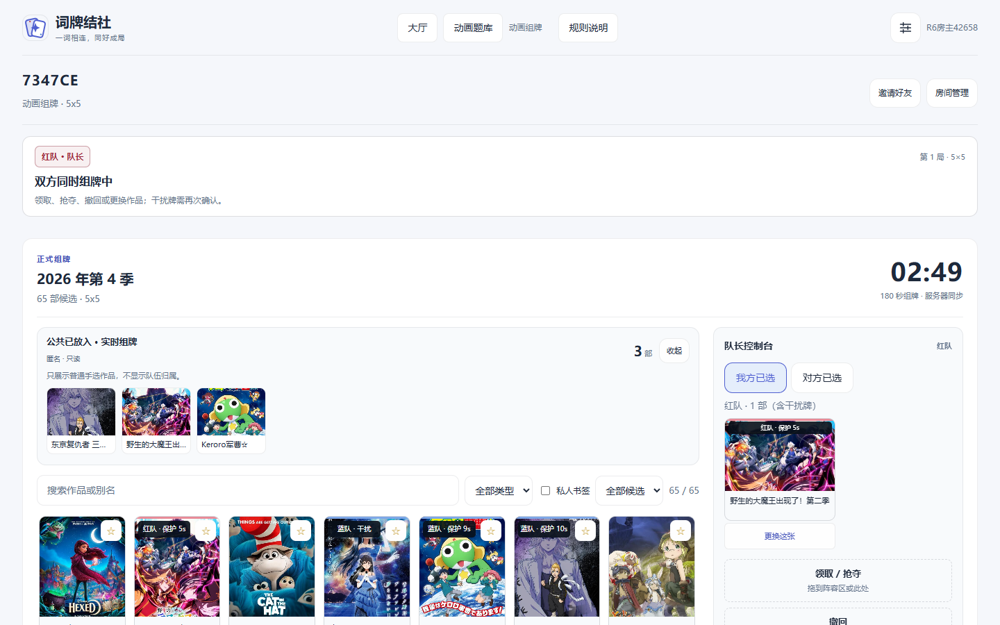

<p align="center"></p>

<h1 align="center">词牌结社 · ACG Codenames</h1>

<p align="center"><strong>把熟悉的动画和梗，变成只有队友能接住的暗号。</strong></p>

<p align="center">一款为 ACG 同好聚会设计的在线联想桌游。<br/>队长给线索，队员猜作品或词牌，在默契与误解之间找到己方的牌。</p>

<p align="center"><a href="http://182.61.136.105/">🎮 立即在线游玩</a> · <a href="#30-秒了解玩法">怎么玩</a> · <a href="#本地运行">本地运行</a></p>

<p align="center"><sub>无须安装客户端 · 支持电脑与手机 · 房号／邀请链接联机</sub></p>


<p align="center"><sub>动画封面棋盘 · 实际游戏界面</sub></p>

## 30 秒了解玩法

**红队与蓝队各有一位队长和若干队员。** 棋盘上的牌暗中属于红队、蓝队、中立或刺客。队长知道牌的归属，队员只看得到牌面。

1. **队长给线索**：说出一个提示词和数字，例如「魔法 · 3」。
2. **队员猜牌**：根据线索讨论并翻开可能属于己方的作品或词语。
3. **揭晓结果**：猜中己方就继续寻找目标；猜到对方、中立或刺客，则可能失去回合甚至直接落败。

先找齐己方目标的一队获胜。你不需要先熟悉代码、设定或复杂规则；**能和朋友接上同一个梗，就能体会这款游戏的乐趣。**

## 三种打开方式

| 模式 | 玩什么 | 适合谁 |
| --- | --- | --- |
| **动画组牌** | 队长从动画作品池挑选封面，组成这一局的秘密牌阵，再用线索引导队友猜作品 | 喜欢新番、经典动画和互相猜梗的朋友 |
| **经典词牌** | 用内置或自定义文字题库玩传统的词语联想与红蓝对抗 | 第一次接触 Codenames 的朋友 |
| **揭幕猜番** | 随着画面逐步揭开，抢先认出动画作品 | 想来一局轻量猜番小游戏的朋友 |

### 一间房间，就能玩起来

**创建房间 → 分享房号／链接 → 选择队伍与队长 → 准备作品池 → 开局。**

不参赛的朋友可以旁观、聊天，也能申请下一局入座；断线后可恢复房间进度。支持多局连续游玩，不必每回合重新拉人。

## 看看游戏长什么样

| 准备大厅 | 动画队长组牌 |
| :---: | :---: |
|  |  |
| 邀请、分队和本局规则集中在同一处 | 拖放或点击挑选作品，双方准备后进入对局 |

| 封面与文字棋盘 | 回合记录与赛后复盘 |
| :---: | :---: |
|  |  |
| 不同屏幕尺寸与深浅主题 | 回看每轮线索、猜牌和最终归属 |

## 不止是翻开 25 张牌

- **大家一起联机**：实时同步线索、翻牌与队伍状态；支持邀请、旁观、聊天、重连与房主管理。
- **属于 ACG 的作品池**：使用动画目录组池，也能创建、收藏或分享作品清单；文字模式支持自定义题库。
- **有策略的队长组牌**：封面挑选、抢夺、干扰与限时准备，让每一局的牌阵都不一样。
- **更方便的对局棋盘**：支持 5×5、6×6 等尺寸、封面／文字显示、个人预判与专注模式。
- **玩完还能复盘**：胜场／积分玩法、回合时间线、终局棋盘、复盘分享和趣味称号。

> **想先试一局？** 打开 [在线体验](http://182.61.136.105/)，创建房间后把邀请链接发给朋友即可。多人对抗通常需要至少四名玩家。

## 本地运行

需要 **Node.js 20+** 和 npm。本仓库为 npm workspaces 项目，包含前端、游戏服务及共享类型包。

```bash
git clone https://github.com/Zao-c/codenames-acg.git
cd codenames-acg
npm install
```

分别打开两个终端：

```bash
# 终端 1：启动游戏服务（默认 3001）
npm run dev:server
```

```bash
# 终端 2：启动前端（默认 5173）
npm run dev:web
```

在浏览器打开 **http://localhost:5173**。可以用不同浏览器或隐私窗口模拟多人加入同一个房间。

检查与构建：

```bash
npm run typecheck
npm run build
```

开发环境配置、缓存服务、部署与详细测试方法以仓库内脚本及相关文档为准。

## 技术栈

**React 19 · TypeScript · Vite**（前端）　/　**Node.js · Express · Socket.IO**（实时游戏服务）　/　**共享 TypeScript 类型与规则**。

代码主要位于 `apps/web`、`apps/server` 与 `packages/shared`。房间动作由服务器判定，客户端按玩家身份接收对应视图，避免把队长的秘密阵营直接发送给普通队员。

## 关于项目

《词牌结社》是面向同好交流的非官方游戏项目，灵感来自桌游 **Codenames /《行动代号》**。与原桌游的发行方没有官方关联。动画名称、封面和相关素材的权利归各自权利人所有。

欢迎通过 [Issues](https://github.com/Zao-c/codenames-acg/issues) 反馈问题与建议，也欢迎在游玩后分享你们想到的离谱线索。