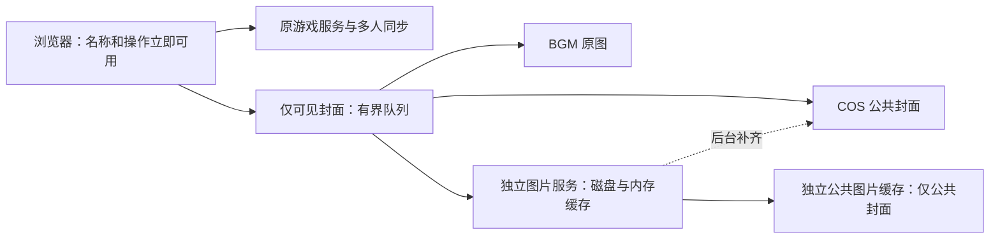

# 封面加载与游戏流畅性修订

已部署：前端 **633ddfd1fa2110bc44315f80cf7240d8d22bae99**；独立图片服务 **f609fa4b3faa1a459659583f9bb6832b9cf674a9**。北京时间 2026-10-21 19:17 仅更新图片工作进程，增加独立公共图片缓存备选，公共 COS 清单已有 986 张匹配封面，失败样本随后也发布成功。正式游戏进程仍为 **37537ea / PID 2886573**，没有重启。网页、游戏编译文件和游戏配置逐文件核验未变。见 [生产审计](production-audit.json)。

优先级按用户要求执行：游戏体验、流畅性、出图率。组牌、抢夺、干扰、倒计时、线索、猜牌和翻牌都不等待封面完成。

## 实现

- 图片服务独立进程，CPU 上限为半核、内存上限 384 MiB；游戏进程不承担新封面的下载、缩放和上传。首次部署时测得图片服务内存约 56 MiB、峰值约 64 MiB；该数值是旧工作进程记录，新版资源指标将随长测报告提供。[资源记录](production-resource-limits.txt)
- 浏览器按可见优先级加载，离开视口的未完成请求可以取消。每标签页同源图片最多一个、图片元数据最多一个，给操作请求留出连接余量。COS、BGM 与本地缓存有界降级；失败保留作品名、阵营和翻牌状态，仍能操作。
- 已有磁盘缓存可以绕过冷下载队列。并发冷请求按原图合并，下载队列、浏览器 URL 缓存、失败冷却和本地内存均有上限。
- COS 使用 AniMatch 的现有服务器配置，原缓存匹配作品 ID 与原图指纹；新增对象使用 `codenames-acg/covers-v1` 命名空间。不会等待 COS 上传完成再返回本地图片。没有更改 AniMatch 的原对象或全桶设置。
- 预热针对当前可见作品，不整池下载 4954 张图。新房间作品池仍由房主明确选择，原有 180 张候选、拖拽、抢夺、匿名视图和全部游戏规则保持原状。
- 私有配置只在服务器保存，公开构建内容已检查不含实际 COS 密钥。图片接口只按服务器目录中的公共 BGM 作品 ID 取图；自建作品及私人内容继续走原权限路径。

## 已完成验证

| 检查 | 结果 |
| --- | --- |
| 类型检查、生产构建 | 通过 |
| 缓存、排队、取消、来源校验单测 | 通过 |
| 120 作品快速滚动、慢元数据响应单测 | 元数据并发 1，同源图片并发 1 |
| 原有多人性能／隐私与分阶段规则单测 | 通过 |
| 八个独立浏览器，4954 作品目录，两局 5×5／6×6 | 444.1 秒，通过 |
| 全部封面源被屏蔽时的真实猜牌 | 8 次，界面确认 P95 342.1 ms；解除屏蔽后恢复 |
| 两局可见棋盘封面检查 | 约 3.1 秒／2.2 秒等待后通过 |
| 正式站同时屏蔽 BGM、COS | 同源缓存恢复，图片请求最大并发 1，无脚本错误 |
| 正式冷封面后台发布到 COS | HTTP 200，上传确认成功，公开对象 HTTP 200 |

短测 ACK P95 256.8 ms，正常猜牌界面 P95 390.4 ms。使用真实线索、确认猜牌、正常胜负、同席重连、桌面拖拽及浏览器原生触控；不是实体手机人工测试。短测对应 c2d0153，最终前端增加的串行元数据保护另通过浏览器单测；最终产物的长测结果见下文。详见 [短测报告](eight-player-short-report.json)、[单测](unit.txt)、[快速滚动检查](metadata-scroll-unit.json)、[原性能检查](existing-performance-unit.txt)、[规则检查](staged-unit.txt)。

COS 后台在短测中补齐 102 张封面，无上传失败。正式冷样本 9270 的图片与上传确认总耗时约 2.46 秒；该耗时包含后台上传确认，不表示游戏或图片响应等待上传。[冷样本记录](production-cos-publication.json)

## 旧版真实失败样本与新缓存复核

旧版 6613e67 基线完成 25 局，在第 26 局的两张封面上超过 90 秒仍未恢复，任务于 6422.8 秒失败，**没有算作三小时通过**。短测与旧基线的目录规模及缓存条件不同，延迟数值仅作为各自运行记录。

两张失败样本为 1957、37458；正式新缓存已针对同一真实图片复核。在浏览器同时屏蔽 BGM 与 COS 后，两张都由正式同源图片路径返回 200，可见图片约 1.65 秒恢复。[原基线失败记录](old-baseline-failure.json)、[同一图片样本恢复记录](baseline-misses-recovery.json)。图片来源原本不存在或外部服务长期不可用时，作品名和游戏操作仍然可用；不声称所有外部请求零失败。

## 缩略图路径故障与原图降级

2026-10-20 15:48 启动的后台长测在 1596.8 秒、完成 4 局后失败。第 5 局有 5 张封面未在 90 秒内恢复，影响 8 个浏览器，未记作三小时通过。记录中的 ACK P95 约 334.6 ms、猜牌界面 P95 约 460.2 ms，无脚本错误；这不等于图片验收通过。[失败与资源记录](attempts/20261020T074830/failure.json)、[逐局图片检查](attempts/20261020T074830/cover-checks.jsonl)。

原版本切换 BGM 域名后仍依赖同一缩略图路径。现已增加相同文件名的原图旁路，下载后由独立进程缩到 400px；代理原图立即尝试，缩略图作为有界备选，成功后取消其余请求。并发冷任务仍为 2，代理连接上限为 4，单次与总截止时间均有上限。不会要求用户等待图片再进入下一阶段。

模拟缩略图一直挂起时，原图分支能成功且会取消挂起请求；非图片响应继续拒绝。五张实际缺图样本绕过本地/COS 缓存下载并解码全部成功，约 0.6–1.4 秒。这个结果不能代替完整长测。[五张样本记录](original-fallback-cold-samples.json)。

## 独立公共图片缓存备选

原图旁路版在 861.8 秒、完成两局后，第三局的作品 413619（非人哉 第二季 13-24集）仍未恢复。这次只剩一张缺图，但影响八个浏览器，也没有记作三小时通过。[失败记录](attempts/20261020T203144/failure.json)、[逐局记录](attempts/20261020T203144/cover-checks.jsonl)。

进一步探测时，BGM 原图、缩略图、备用域名及现有代理均发生连接超时。新版增加 Weserv 独立公共图片缓存作为备选，成功后仍返回本地缩略图并后台发布到本项目 COS 命名空间。只传目录中公共 BGM 封面地址，不传用户、房间、Cookie、授权头、带签名查询或片段的 URL；私有/自建图片沿用原权限路径。可用 `COVER_PUBLIC_MIRROR_ENABLED=0` 关闭该备选。该服务定位为后备线路，不能代替已有本地/COS 缓存。[服务说明](https://wsrv.nl/faq/)。

真实故障注入中，BGM 路线全部强制失败、绕过本地/COS 后，同一作品仍在约 2.84 秒返回有效 WebP。正式图片接口再复核，约 2.44 秒返回 200，独立缓存取图计数增加 1，随后后台发布成功且 COS 公开访问为 200。浏览器再同时屏蔽外部图源，约 1.70 秒由正式同源缓存显示作品，未发生脚本错误。[真实取图验证](mirror-real-recovery.json)、[正式发布记录](mirror-production-publication.json)、[浏览器恢复记录](mirror-production-recovery.json)。

## 三小时测试

2026-10-21 19:21 启动的测试在干扰作品搜索遇到两部同名《X战记》时，因测试脚本按显示名称定位而中断，并非组牌操作或图片请求超时。已完成 27 局的 27 次可见棋盘封面检查均通过，最慢一次等待约 31.48 秒，浏览器脚本错误为零；这不能代替完整三小时验收。现已将测试定位改为作品 ID，并在真实浏览器中复现两张同名卡片，验证分别点击两个 ID 均准确命中。仅修改测试脚本，正式游戏与图片服务产物保持不变。[定位复核](duplicate-title-locator-check.json)

<!-- SOAK_STATUS -->
本次八浏览器长测运行 7169.8 秒、完成 27 局后失败，未记作三小时通过。详见 [失败记录](three-hour-failure.json)、[指标摘要](three-hour-summary.json)、[产物核验](three-hour-artifact-audit.json)。
<!-- /SOAK_STATUS -->

结束后已核验网页、图片服务及游戏产物，并记录内存、事件循环、延迟、逐局封面恢复和错误统计。原矩阵的 PNG 导出停滞另有历史记录，本轮未将它记作完整通过。

## 截图

- [旧基线棋盘：两张封面未恢复](screens/old-baseline-board-failure.png)
- 新方案：[手机棋盘](screens/round-0-board-mobile.png)、[桌面干扰工作区](screens/round-0-interference-0.png)、[手机浅色](screens/round-0-interference-mobile-light.png)
- [全封面源屏蔽时仍完成猜牌](screens/guessing-with-all-cover-sources-blocked.png)、[解除屏蔽后恢复](screens/covers-recovered-after-unblocking.png)
- 正式缓存回退：[桌面深色](screens/production-cache-fallback-desktop.png)、[手机浅色](screens/production-cache-fallback-mobile.png)
- 旧失败样本的新恢复验证：[桌面](screens/baseline-misses-recovery-desktop.png)、[手机](screens/baseline-misses-recovery-mobile.png)。恢复截图使用同一图片样本，不是同一对局的截图。

- 最新失败样本对照：[修复前棋盘缺图](screens/old-failure-413619-board.png)、[恢复后桌面浅色](screens/mirror-recovery-desktop-light.png)、[恢复后手机深色](screens/mirror-recovery-mobile-dark.png)。后两张使用同一作品的只读首页夹具，并非同一局棋盘。
