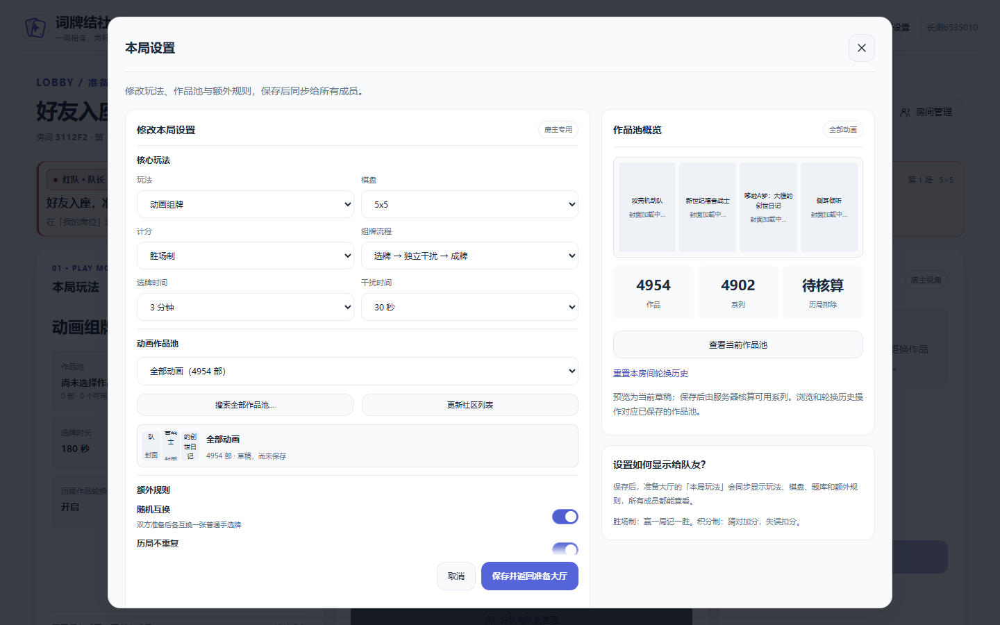
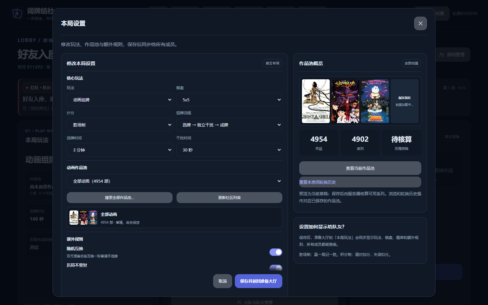
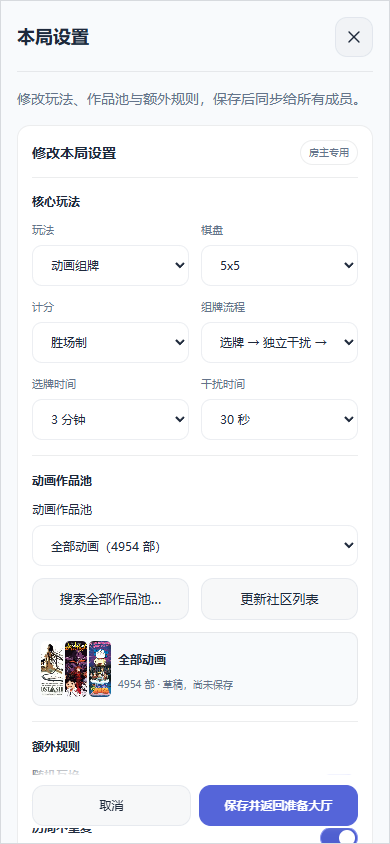
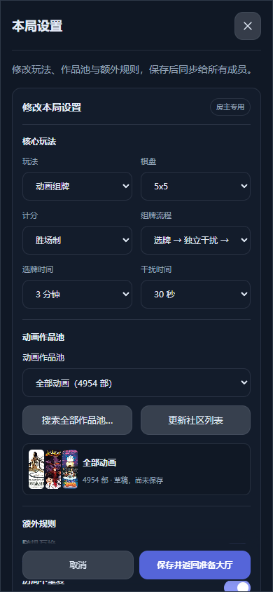
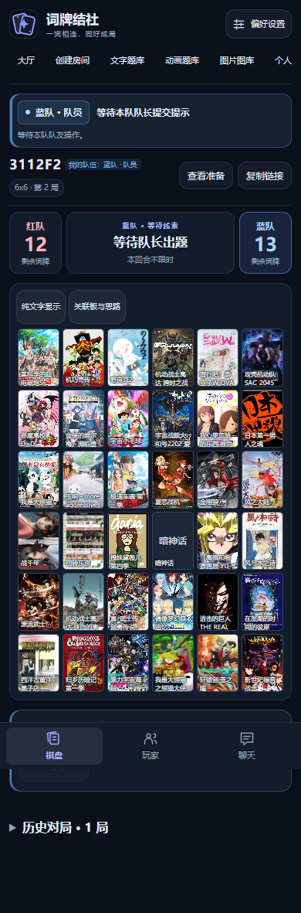
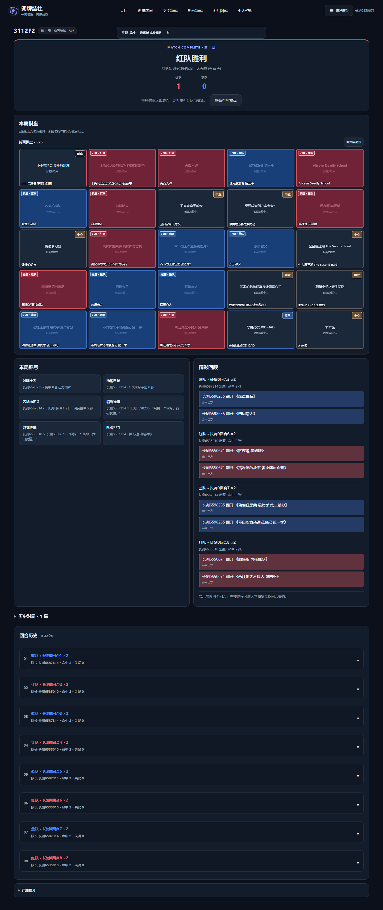
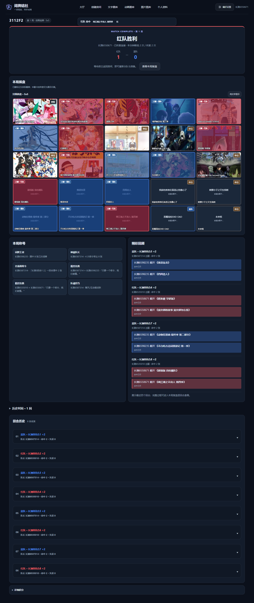
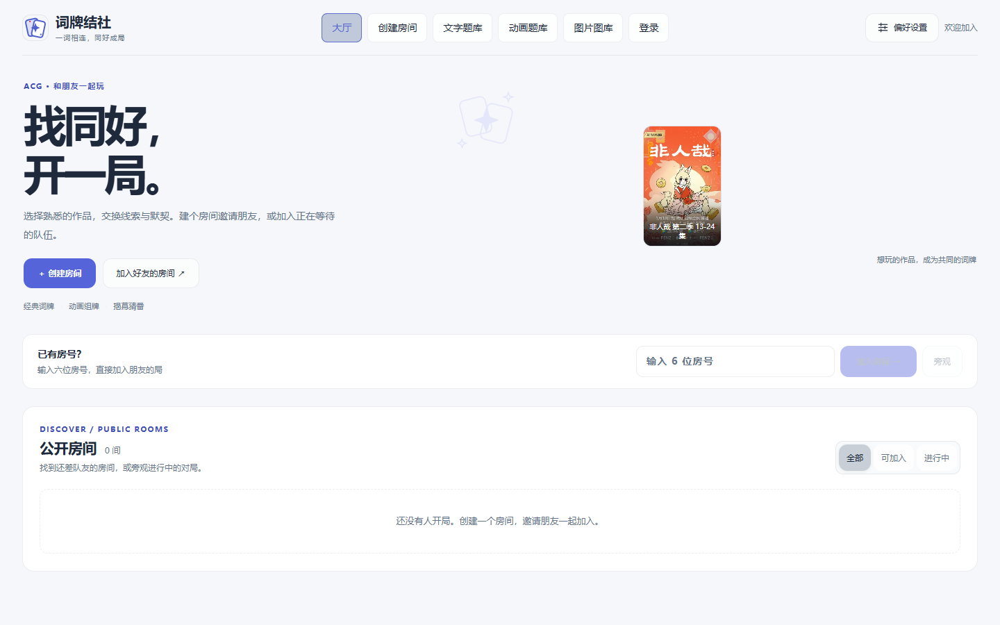
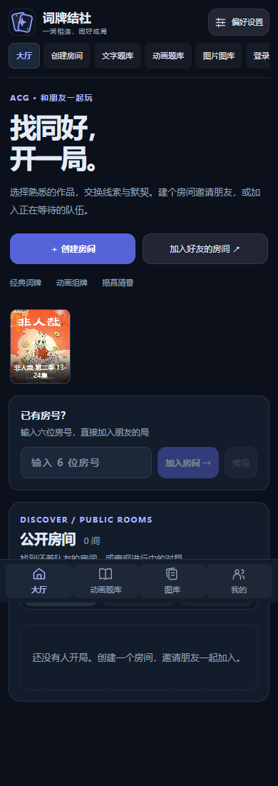

# 图片恢复热修复与长测故障诊断（2026-10-22）

前端修复已于北京时间 **2026-10-22 20:38** 发布，正式游戏进程与图片服务均未重启。**三小时验收仍未通过。**

## 实际游戏修复

| 已复现的问题 | 修改前 | 修改后 |
| --- | --- | --- |
| 健康备用图需要 3 秒，但前端 2 秒提前取消 | 约 2.89 秒报错 | 约 3.88 秒成功显示 |
| 全局 6.5 秒计时把排队也算作下载时间 | 8 张正常图片只有 5 张成功 | 8/8 成功，同源并发保持 1 |
| 快速滚出再滚回，订阅到旧的已取消任务 | 第二次订阅 AbortError | 新任务成功；第三个订阅共享同一次下载 |

同源备用请求超时调整至 10 秒，覆盖图片服务冷加载预算；超时从实际下载开始计算。离屏请求仍可取消，最后一个订阅退出立即移除任务，旧任务清理不能误删新任务。图片始终后台加载，游戏操作无需等待。

证据：[修改前](before.json)、[修改后](after.json)。另验证离屏取消清空队列、一位订阅者离开不取消其他人的共享下载。上述为真实浏览器确定性网络夹具，不能当作生产加载速度。

## 已完成验证

- 类型检查、完整构建、图片服务/队列/元数据滚动/浏览器恢复专项通过。构建存在原有 chunk 体积提示。
- 八个独立浏览器完成 5×5 与 6×6 两局，持续 **450.5 秒**；包括鼠标与触屏拖牌、提前完成、干扰、互换、猜牌、正常胜负、返回房间、重连及隐私检查。
- 操作 ACK P95 **389.6 ms**，猜牌界面 P95 **552.9 ms**。
- 屏蔽全部图片源后实际猜牌 8 次，P95 **408.3 ms**，解除屏蔽后封面恢复。
- 两局可见棋盘封面检查均通过；控制台脚本错误为 0。网络失败计数包含主动故障注入，不能等同于最终缺图数量。
- 发布后只读浏览器屏蔽 BGM/COS/外部镜像：历史失败作品 413619 通过线上独立缓存返回 200，约 **1.71 秒**可见，同源最大并发 1；桌面浅色及手机深色通过。

详见 [八人报告](eight-player-report.json)、[线上浏览器检查](production-browser-check.json)、[类型检查](typecheck.txt)、[构建](build.txt)。

## 发布版本与审计

- 产品修复提交：`809c063`。
- 测试前端提交：`fef3655`。
- 生产热修复提交：`ec74565b39d156f1eee97610b4a4b967f5d0f405`，从实际线上 `633ddfd` 仅 cherry-pick 产品修复，未混入其他 PR。
- 游戏运行版本：`37537ea1d351956c226456ad4c5685509f8e04df`。
- 图片服务版本：`f609fa4b3faa1a459659583f9bb6832b9cf674a9`。
- 发布的 10 个网页静态文件与实际八人测试产物逐字节一致。Linux 编译通过后提升已测静态产物；未放宽哈希校验。
- 先上传资源、保留旧哈希文件，再切换首页；未重启服务、修改游戏配置或迁移用户数据。

详见 [静态产物核验](linux-artifact-verification.json)、[发布记录](production-audit.json)、[发布后 HTTP 哈希及进程复核](production-postcheck.json)。公开报告仅保留版本、哈希和验证结论；完整路径、进程号及运行指标保留在本地审计中。

## 最近三小时测试为何失败

旧测试运行约 59.4 分钟、完成 **13 局**后，测试驱动 Node 的 192 MiB 堆耗尽并 SIGABRT。不是正式游戏进程或图片服务退出。原兜底报告丢失了局数；[逐局日志恢复记录](prior-soak-diagnostic.json)保留真实 13 局，验收仍为失败。

找到了可独立复现的驱动内存增长路径：订阅每个 Playwright Request/Response 使其网络对象在框架回收阈值到达前持续保留。相同八个持久浏览器、6,400 张本地图片、相同 192 MiB 堆上限的对照：

| 采集方式 | 起始堆内存 | 结束堆内存 | 保留 Request 对象 |
| --- | --- | --- | --- |
| 原 Playwright 网络事件订阅 | 21.1 MiB | 128.7 MiB | 6,408 |
| CDP 网络事件采集 | 21.2 MiB | 25.2 MiB | 8 |

新采集器消费普通事件数据，完成或失败即清除临时记录。保留图片成功、HTTP 失败、网络失败、目录请求和 Socket.IO 轮询报文检查；不提高堆上限、不清空玩家会话、不降低验收标准。测试验证 6,408 个图片响应、8 个 HTTP 错误、8 个网络错误、8 次目录请求和 8 个轮询报文，结束待处理记录为 0。

证据：[原采集器](driver-memory-before.json)、[新采集器](driver-memory-after.json)。这是对一个明确增长路径的修复，尚不能证明三小时全部问题已解决。本轮没有再启动三小时测试。

新采集器的真实八人短回归也已通过：持续 **451.7 秒**、两局 5×5／6×6，ACK P95 **266.5 ms**、猜牌界面 P95 **418.6 ms**；全图屏蔽下真实猜牌 8 次并恢复。记录 22 次全量、1,540 次增量、40 次猜牌、20 次线索、2 次重连，页面脚本错误为 0。驱动堆采样从 34.8 MiB 到 41.4 MiB，采样峰值 53.3 MiB；短测不足以外推三小时稳定性。详见 [新采集八人报告](observer-eight-player-report.json)、[驱动采样](observer-driver-memory.json)、[对应版本](observer-manifest.json)。

兜底报告同时改为从持久化 `rounds.jsonl` 恢复已完成对局；末尾写入截断会明确标注，始终保持失败状态，不会把失败测试改记为成功。

## 截图

