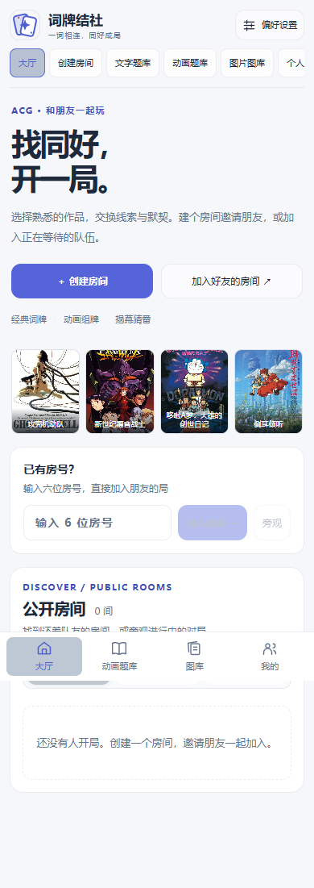

# 截图反馈修订 · 生产部署

已发布到 [正式网站](http://182.61.136.105/)。本会话已有的部署授权继续适用于本次修订；PR [#18](https://github.com/Zao-c/codenames-acg/pull/18) 保留待评审，没有合并。

| 项目 | 核验结果 |
| --- | --- |
| 原生产提交 | `0e09d0aae15bccf8b94687184fffa4c1c79581a5` |
| 本次实际 Git／运行提交 | `89b5f70485b7c0a9ca1e70e2e414b9ed6731da6b` |
| 发布时间 | 2026-10-19 08:09:00 UTC／北京时间 16:09:00 |
| 服务 | codenames.service，active／running，PID `2267745`，NRestarts=0，ExecMainStatus=0 |
| Node | v22.22.2 |
| 健康 | `{"ok":true}` |
| 切换前房间 | 0，没有强制清除真实对局 |
| 数据／编译核验 | 48 个持久文件、74 个编译文件全部通过 |
| 配置 | `.env` 与发布前归档逐字节一致；服务及 Nginx 配置未修改 |

应用代码与最终专项测试 `7f9bfda` 一致；之后的提交只增加测试修正、文档和证据。发布后追加报告不代表服务器再次更新，运行版本以 [runtime-after.json](runtime-after.json) 为准。

## 执行与公网复核

使用 [发布脚本](../../scripts/deploy-round10-feedback.sh) 校验预期生产 HEAD、tracked clean、祖先关系和 bundle 完整性，在独立目录构建。锁文件相同，复用原有依赖并修正工作区链接；没有变更依赖、环境配置、权限和游戏规则。

Linux 上构建 shared／server／web，并以真实入口 `apps/server/dist/apps/server/src/index.js` 在 3199 端口、隔离数据目录启动成功。再核实生产空房，停止写入后创建一致性备份，核验归档与持久路径，切换三个编译目录，验证数据和产物后启动服务。就绪轮询开始时的连接拒绝随后恢复，最终检查成功，没有触发回滚。原始输出见 [deployment.txt](deployment.txt)。

通过 [只读审计](../../scripts/audit-round10-deployment.py) 验证实际 PID、工作目录、启动入口、Git／release SHA、备份、配置和公开资源。Nginx 返回的文件与新构建逐字节相同：

- JS `/assets/index-DSNESOlk.js`：`e2e5e013d65260eb8a9a056d68538c8e8019cf8b9e753361bd1243c0128ae587`
- CSS `/assets/index-DDUU21BX.css`：`5e007bb5266ec462f7a0d53f8797b50335c8a1a1de8a67a1b3050f4bb73f8fec`

真实浏览器只读验证公网桌面深色、手机浅色页面，六项主导航一致，新资源 HTTP 200、脚本错误 0，见 [公网浏览器结果](production-browser.json)。只在浏览器本地设置游客身份，没有创建生产账号、房间或比赛。完整多人流程在隔离服务验收。

| 桌面深色 | 手机浅色 |
| --- | --- |
|  |  |

## 备份与回滚

备份目录：`/opt/codenames-backups/round10-feedback-20261019T080815Z-89b5f70485b7`。

| 归档 | bytes | SHA256 |
| --- | --- | --- |
| app-before.tar.gz | 71967706 | `3747d91289fd49086191664ad5aa5ede7634359797381ac54a974b78e2d9d440` |
| system-before.tar.gz | 11975 | `f44dc35db81dad7d5c89fa7acc62413df232b8b71b9fff0b8e6ef5dd42307dd2` |

归档可读、SHA256 一致，共 725 个条目，全部真实持久路径已覆盖，包括用户、作品池、导入、自建作品、封面及嵌套 reveal-images 目录；配置归档保留于服务器 root 保护目录，内容未上传仓库。没有宣称做过恢复演练。

发布脚本内置失败后恢复原 `0e09d0a`、三个编译目录和 release.json 的代码回滚，本次未触发。未来回滚须先重新核对版本和空房、停止服务，只恢复备份 `code/` 下 shared／server／web 的 dist 和 `release.json.before`，再启动检查。不能用整个旧 app 归档覆盖新用户数据；活跃内存房间不能靠磁盘归档恢复。

测试矩阵、原始结果、前后截图和已知验证边界见 [本次验收](README.md)。
