# Round 10 截图反馈修订

本次针对用户九张截图反馈增量修改，接续 PR [#18](https://github.com/Zao-c/codenames-acg/pull/18)。核对基线：工作区／PR `b174756`，生产 `0e09d0a`，main `f4dba98`，原工作区与 Round 9 均没有 tracked 修改。继续使用原独立 worktree，没有覆盖 main 或其他工作区。

## 反馈与实际修订

| 反馈 | 修订 |
| --- | --- |
| 图 1 设置缺少图 2 的分区 | 桌面双栏：左侧核心玩法、动画作品池、额外规则，右侧真实封面预览、作品／系列／排除数量和同步说明。保存／取消靠右，不再拉成整行；窄屏为全屏可滚动层。 |
| 图 3 分队与队长工具 | 改成「分队与队长管理」页内弹窗，保留队长任命、保留队长随机和全员随机；调整即时同步，关闭按钮明确为「完成并返回大厅」。主大厅的成员拖放和逐成员管理继续保留。 |
| 图 4 两个同样图标 | 全局入口显示「偏好设置」，房间入口使用成员图标和「房间管理」文字，含义可直接区分。 |
| 房主／社长混用 | 前端按钮、房主接任提示及成员身份统一使用「房主」，包括「转让房主」。权限和后台操作名称没有变更。 |
| 图 5、6、9 房间导航不同且有灰色标签 | 大厅、准备、组牌、对局和结算共享同一组主导航；移除伪装成按钮的房间玩法标签。手机主导航水平滚动，底部房间标签继续用于切换棋盘、成员和聊天。 |
| 图 7 两侧三角 | 移除原生折叠标记和手写下箭头的叠加，仅保留「管理 ⋯」菜单入口，鼠标及键盘操作保留。 |
| 精彩回顾只有线索与次数 | 使用实际回合记录展示出题者、线索、猜牌者、实际翻开的作品和己方命中／对方／中立／刺客结果。没有猜牌的回合明确显示“本回合未翻牌”。 |
| 图 8 棋盘靠后且折叠 | 胜负信息后立即显示默认展开的终局棋盘，称号、精彩回顾、下一局和历史位于其后；终局棋盘去掉内部裁剪，所有行都可随页面浏览。 |

附件图 2 只作为布局参考。其演示中的新时长、独立干扰等未确认规则未启用；选牌保持 180 秒，干扰保持选牌期间每队一张。拖拽、抢夺、撤回、互换、轮换、匿名投影、关联板和服务端权限不变。

右侧封面预览只在房主主动打开设置时读取，复用原本需要身份、房间、计划和版本验证的接口，`preview=1` 仅返回最多四部真实作品，避免为四张缩略图传输整个大池。旧完整读取接口、权限检查和响应格式保持兼容；没有向成员广播增加目录或作品池详情。

## 验证

<!-- RESULTS -->

**25／25 条命令通过，本轮 23 项专项、156 张截图。** 测试提交 `7f9bfdafff1e116b69fbf058ac062f7de1f8afe9`。

| 命令 | 结果 | 秒 |
| --- | --- | --- |
| `npm run test:rules` | 通过 | 30.76 |
| `npm run test:round10:unit` | 通过 | 3.74 |
| `npm run test:e2e:local` | 通过 | 58.09 |
| `npm run test:stability:local` | 通过 | 58.25 |
| `npm run test:mixed:local` | 通过 | 62.96 |
| `npm run test:lobby:local` | 通过 | 30.49 |
| `npm run test:browser:local` | 通过 | 67.54 |
| `npm run test:phase2:local` | 通过 | 23.68 |
| `npm run test:bangumi:local` | 通过 | 109.63 |
| `npm run test:concentrated:local` | 通过 | 133.31 |
| `npm run test:round6:roles:local` | 通过 | 27.36 |
| `npm run test:round7:ui:local` | 通过 | 81.06 |
| `npm run test:round7:faults:local` | 通过 | 57.92 |
| `npm run test:round7:load` | 通过 | 56.97 |
| `npm run test:performance:unit` | 通过 | 3.79 |
| `npm run test:performance:browser` | 通过 | 242.15 |
| `npm run test:round9:local` | 通过 | 115.78 |
| `npm run test:performance:load` | 通过 | 74.56 |
| `npm run test:round10:local` | 通过 | 355.94 |
| `npm run test:round5:local` | 通过 | 66.68 |
| `npm run test:round6:local` | 通过 | 341.83 |
| `npm run test:round8:local` | 通过 | 106.21 |
| `npm run test:round8:large:local` | 通过 | 101.93 |
| `npm run typecheck` | 通过 | 11.9 |
| `npm run build` | 通过 | 14.29 |

完整记录见 [test-results.json](test-results.json)、[browser-after.json](browser-after.json) 和 [性能对比](performance-comparison.json)。手机弱网、61 秒慢图和增量同步保留专项通过。

<!-- END RESULTS -->

兼容回归中的早期失败没有计为通过。Round 5 的快速模拟出题触发原有每 10 秒 3 次限制，测试增加真实等待，保留原限流。Round 6 在手机触控前聚焦页面、等待原有 dock 动画稳定，再使用连续触点移动并核对真实落点；仍检查短滑不选中、长按幽灵和实际入牌，没有修改产品手势实现。Round 8 在受控导出前读取四张实际 CDN CORS 封面，记录网络可达性，再执行原 PNG 封面断言；没有用占位图替代真实导出，也没有修改产品超时或故障恢复规则。

手机使用 Chromium 触屏模拟；没有实体 iOS／Android 或三小时公网长测。大于 500KB 的既有 chunk 提示保留。测试使用隔离数据和端口；生产验证不会创建测试账号或房间。

相邻串行 loopback 性能比较使用 8 人、180 候选、240 次操作和 5000 条额外目录夹具：房间传输 `1,970,853 → 1,970,873 bytes`（约 +0.001%），ACK P95 `55 → 52ms`。传输 ≤105%、P95 ≤基线×1.25＋20ms 的门禁均通过；这是同机回归数据，不是公网速度保证。仓库未配置托管 CI，25 条通过记录来自本地执行。

## 对照与交付

前图来自上一轮真实应用截图，源码 `20a30b1`，应用内容与当时生产 `0e09d0a` 一致。后图来自本轮真实组件及真实多人操作，不使用附件模拟数据代替验收。对照图、权限、视口和哈希记录在 `screens/manifest.json`，本地完整索引为 `output/playwright/round10-feedback/review.html`。附件原图和 HTML 演示素材留在本地。

<!-- SCREENS -->

| 场景 | 修改前 | 修改后 |
| --- | --- | --- |
| feedback-settings-1440-light.png | 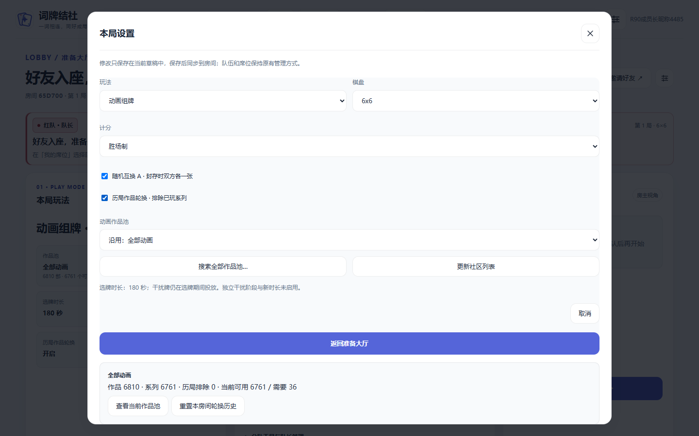 | 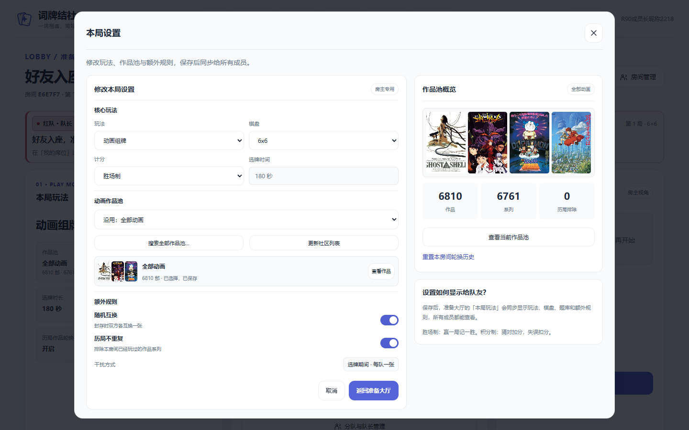 |
| feedback-settings-390-dark.png |  | 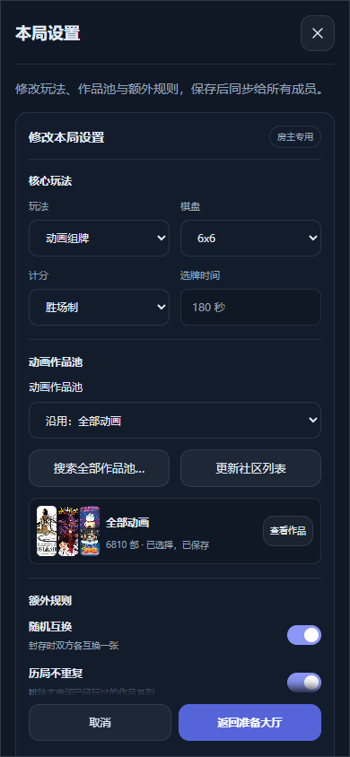 |
| feedback-team-management-1440-light.png | 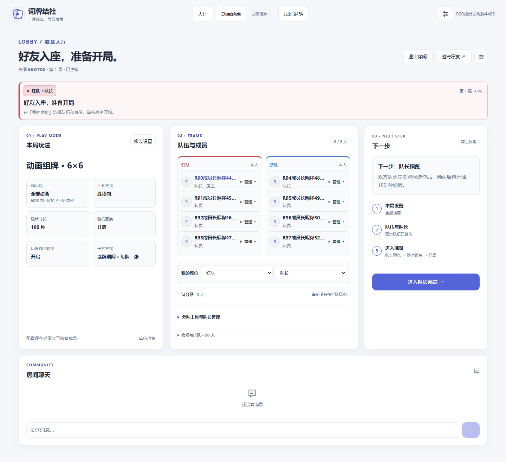 | 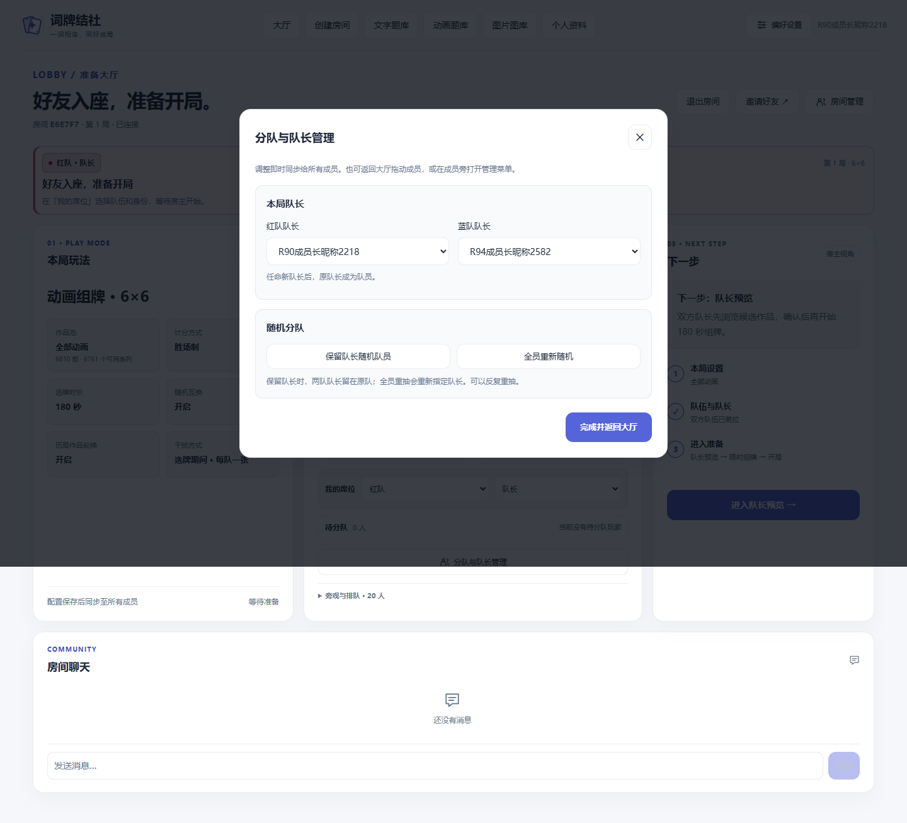 |
| feedback-room-management-1440-light.png |  | 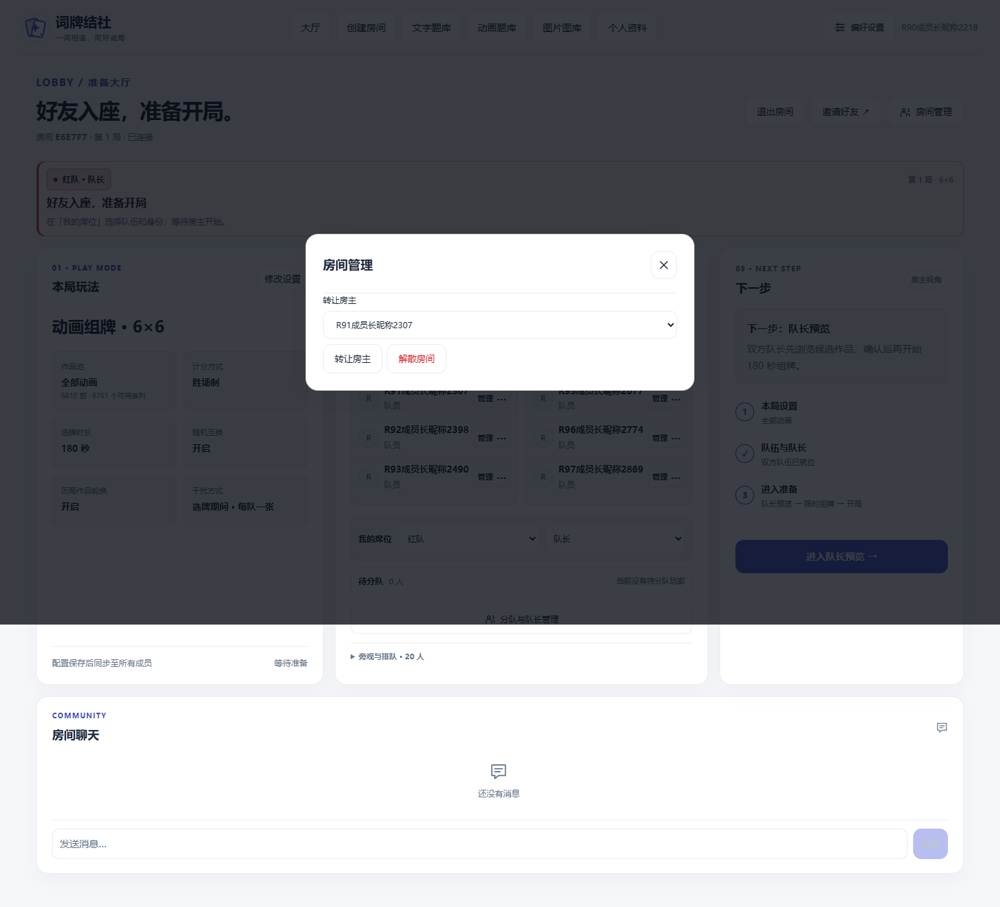 |
| lobby-1440-light.png |  | 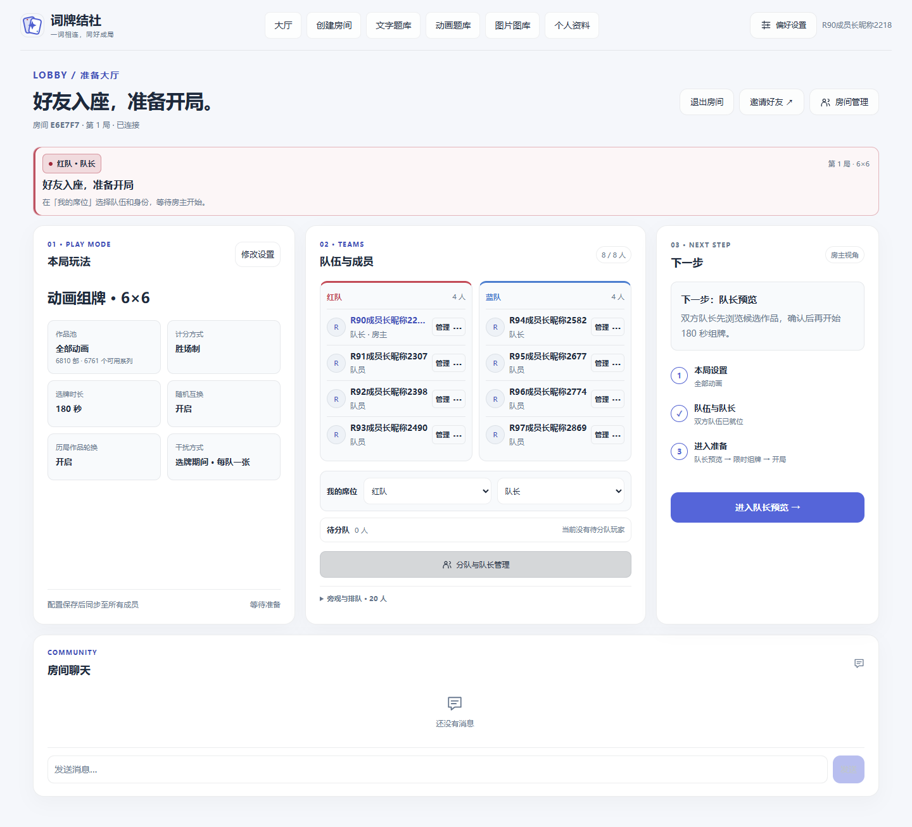 |
| lobby-390-dark.png | 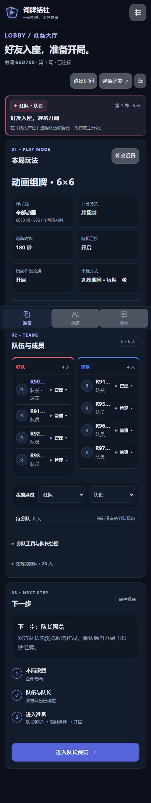 | 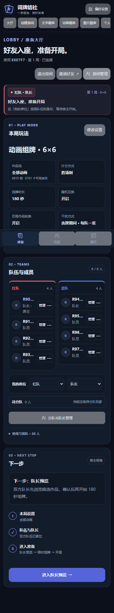 |
| flips-6x6-1440-dark.png | 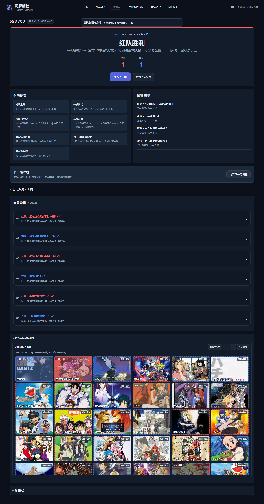 | 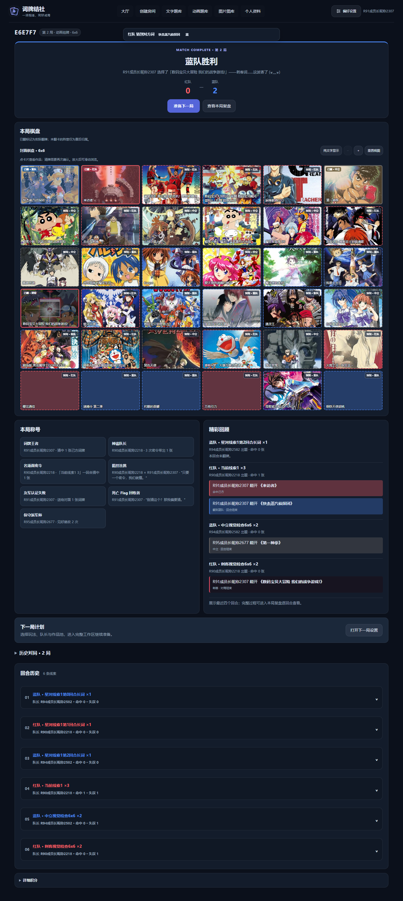 |
| flips-5x5-390-light.png | 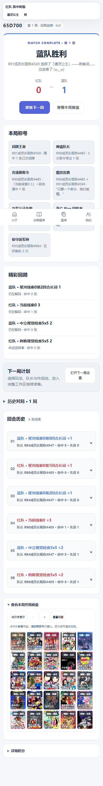 | 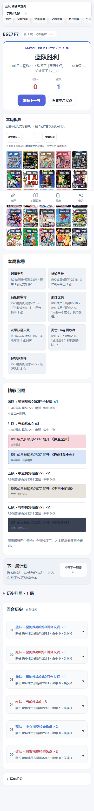 |

<!-- END SCREENS -->

发布与实际运行 SHA 见 [部署记录](DEPLOYMENT.md)。只在测试通过、PR 可审阅且生产空房时，按本会话已有的部署授权发布；先停写做一致性备份，失败只回滚代码，保留最新用户数据。

## 模块提交

- `8f35667`：参考稿双栏设置与受保护的四图预览。
- `f7dc5e9`：统一导航、区分管理入口、分队弹窗和房主文案。
- `8c12555`：终局棋盘优先、实际翻牌回顾。
- `034ef35`：新增反馈专项及兼容测试入口。
- `937fc1f`：设置说明位置与草稿浏览边界。

后续证据与部署提交见 [PR 历史](https://github.com/Zao-c/codenames-acg/pull/18/commits)。
