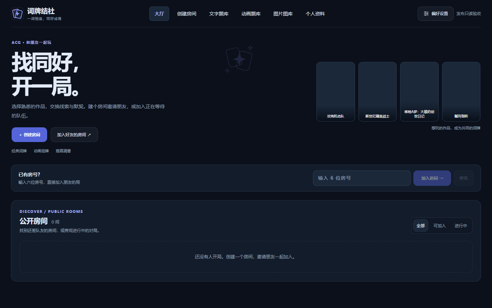
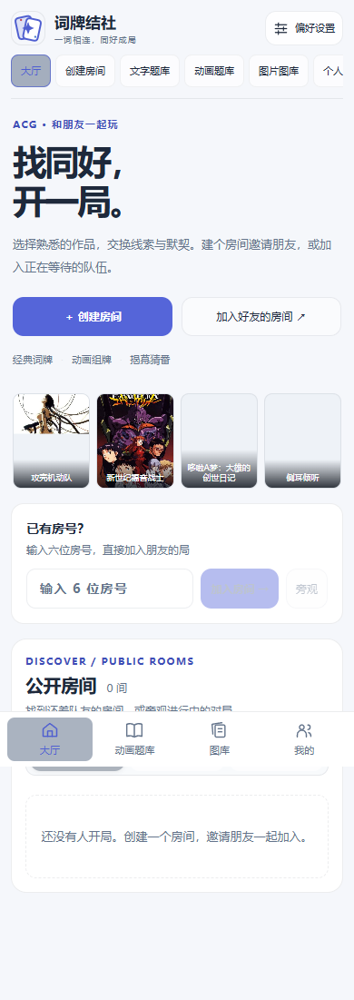
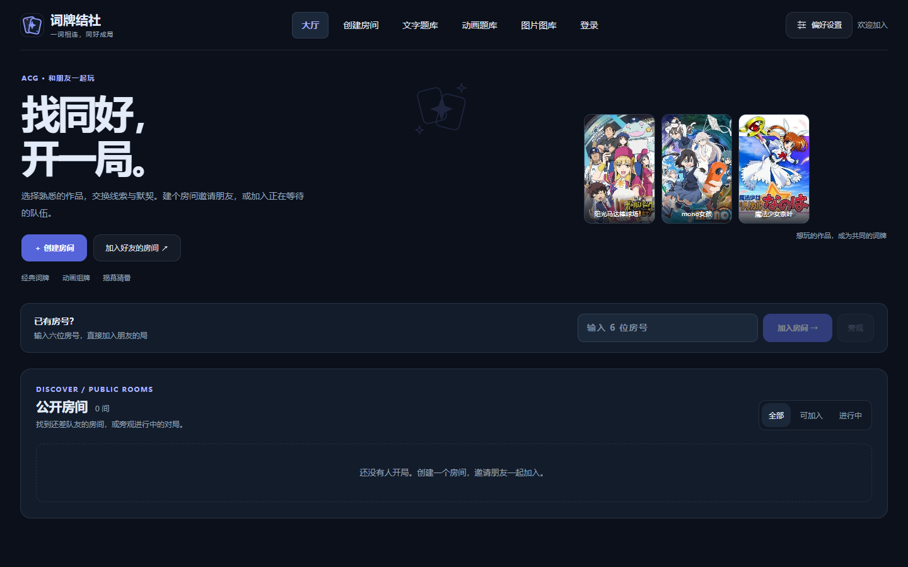

# 发布与线上验收

2026-10-19 北京时间 **18:14:29** 发布至 `182.61.136.105`。

- 运行提交：`a73ad5afb87522ad472b5c4bc2f529e3eec5e169`；此前运行 `89b5f70485b7c0a9ca1e70e2e414b9ed6731da6b`。
- PR：[Zao-c/codenames-acg#18](https://github.com/Zao-c/codenames-acg/pull/18)。后续验收文档提交不改变已发布应用代码。
- 发布前房间列表为空，生产代码无未提交修改；脚本在停止服务前再次检查房间和版本。
- Node `v22.22.2`；`codenames.service` 为 `active/running`，PID `2459853`，`NRestarts=0`、`ExecMainStatus=0`，健康检查为 `{"ok":true}`。
- Linux 暂存版本临时端口冒烟通过；实际入口仍为 `apps/server/dist/apps/server/src/index.js`，服务工作目录仍为 `/opt/codenames-acg/apps/server`。
- 53 个持久文件在重启前完成校验，74 个编译文件核对成功；账户、作品池、导入、自建作品、封面与嵌套揭牌图片数据路径均纳入备份，原 `.env` 内容保持一致。

备份：`/opt/codenames-backups/round10-room-cover-20261019T101346Z-a73ad5afb875`。

| 备份 | 大小／字节 | SHA-256 |
| --- | ---: | --- |
| app-before.tar.gz | 78,386,962 | d5eada3fec411172e880c72f8c7d453cbb5408277c510b023dca9e4676ddf76e |
| system-before.tar.gz | 11,975 | f44dc35db81dad7d5c89fa7acc62413df232b8b71b9fff0b8e6ef5dd42307dd2 |

保留的 `code/` 包含原三个编译目录，`previous-sha.txt` 记录原提交。发布失败会自动恢复代码与旧编译产物；后续手工回滚也应保留实时用户数据。

| 线上资源 | SHA-256 |
| --- | --- |
| /assets/index-BBbiMbfn.js | d6208565810908effddfb2c5555379ee200d077df205bc81eb64ad598980f5be |
| /assets/index-B1joaJ7m.css | e4d0dfee97682bbdd9f1e213913eb43ce612e97ca24b1ed0bcffe28ea0e40d35 |

线上 HTML 引用与编译资源一致，两项资源均 HTTP 200；真实浏览器检查六项导航、桌面深色与手机浅色，JS 错误为零，手机无横向溢出。见 [运行审计](runtime-after.json)、[浏览器结果](production-browser.json) 与[发布日志](deployment.txt)。

用户截图中的三部作品经同一封面接口复测全部 HTTP 200；其中 `mono女孩` 从旧版 4.50 秒返回 503，恢复为新版 9.69 秒成功下载 65,886 字节 WebP，见[发布前](covers-before.json)和[发布后](covers-after.json)。随后真实浏览器阻断外部 CDN，三张同一作品封面均通过正式同源缓存成功显示，加载占位消失，见 [备用恢复结果](production-covers.json)。这些验证只读取公开目录与图片，未创建生产房间、账号或对局。

