# 词牌结社 Round 10 V2 验收

本轮修改准备大厅、本局设置和翻牌视觉，延续原有视觉风格。独立 worktree 从 GitHub 最新 main 建立，先核实生产 `59f2bd1` 和 Round 9 最终成果；详见 [基线](BASELINE.md) 与 [评审记录](REVIEW.md)。PR：[Round 10 V2 #18](https://github.com/Zao-c/codenames-acg/pull/18)。生产部署结果另见 [DEPLOYMENT.md](DEPLOYMENT.md)，不能用 PR HEAD 代替实际运行 SHA。

## 三项修订

- 大厅保留三栏并增加纵向空间，玩法与规则摘要对所有成员可见，队伍保留拖放与管理入口，下一步显示准备进度和主按钮。4／8 人、3／5 不均衡队伍均采集截图；1024px 下一步换行，手机纵向可滚动。
- 房主在桌面弹窗／390px 全屏层中修改玩法、棋盘、作品池和额外规则。无修改返回不写入，有修改取消需确认；保存期间锁定操作，核对服务端同房间、同计划、目标版本和持久设置。ACK 丢失先同步读，不自动重发；拒绝／不确定时保留草稿，支持核对和显式重试。切房后的旧 ACK 不关闭新房间的草稿。
- 封面上的红、蓝、棕、灰蒙层覆盖整牌，标题没有实色底带；真实封面继续由原有 Cover 组件加载。已翻与队长未翻预知的标签、边界不同。文字、公开复盘和 Canvas 导出使用一致的真实翻牌语义。

## 自动化验收

最终结果由 [test-results.json](test-results.json) 记录每条命令、退出码和耗时；复现入口为 `npm run verify:round10`。这套入口按顺序执行，避免多套浏览器和压测竞争资源。早期失败已在 [评审记录](REVIEW.md) 说明，不计为通过。

以上为本地执行结果。仓库没有 GitHub Actions workflow，PR 未报告托管 CI 检查；不将此情况表述为 CI 已通过。最终视觉验收后只增加测试证据、文档和部署工具，应用源码保持一致。

<!-- RESULTS -->

最终 **25／25 条命令通过**。Round 10 专项 **19 项检查、149 张截图**；没有页面脚本错误。测试源码提交 `20a30b1c9cea445b3417b1371c0bc97575460a5c`，基线 `26fe2abc633c5f54f1161ee7d75e419cb12e295e`。

| 命令 | 结果 | 秒 |
| --- | --- | --- |
| `npm run test:rules` | 通过 | 35.22 |
| `npm run test:round10:unit` | 通过 | 4.72 |
| `npm run test:e2e:local` | 通过 | 55.93 |
| `npm run test:stability:local` | 通过 | 58.28 |
| `npm run test:mixed:local` | 通过 | 63.68 |
| `npm run test:browser:local` | 通过 | 68.67 |
| `npm run test:phase2:local` | 通过 | 23.79 |
| `npm run test:bangumi:local` | 通过 | 110.34 |
| `npm run test:round6:local` | 通过 | 343.61 |
| `npm run test:round6:roles:local` | 通过 | 29.7 |
| `npm run test:round7:ui:local` | 通过 | 80.53 |
| `npm run test:round7:faults:local` | 通过 | 59.03 |
| `npm run test:round7:load` | 通过 | 56.89 |
| `npm run test:performance:unit` | 通过 | 3.45 |
| `npm run test:performance:browser` | 通过 | 238.2 |
| `npm run test:round9:local` | 通过 | 127.51 |
| `npm run test:performance:load` | 通过 | 73.89 |
| `npm run test:round5:local` | 通过 | 47.99 |
| `npm run test:concentrated:local` | 通过 | 131.65 |
| `npm run typecheck` | 通过 | 13.47 |
| `npm run build` | 通过 | 14.42 |
| `npm run test:lobby:local` | 通过 | 29.19 |
| `npm run test:round8:local` | 通过 | 122.32 |
| `npm run test:round8:large:local` | 通过 | 112.24 |
| `npm run test:round10:local` | 通过 | 304.54 |

<!-- END RESULTS -->

专项 [修改后结果](browser-after.json) 与 [修改前结果](browser-before.json) 记录测试版本、真实角色权限、视口、封面加载数量、几何尺寸和页面错误。像素校验仅将四张实际已翻牌的图片请求替换为平灰夹具，比较同一蒙层上、下采样 RGB；对照截图和 PNG 在这个故障注入之前采集，使用实际封面。

多人流程包括 8 位玩家、3 位真实浏览器旁观加 17 位 Socket 旁观；5×5／6×6 三局完整准备、队长预览、组牌、封存、倒计时、出线索与确认猜牌。红、蓝、中立、刺客都通过实际猜牌翻开。覆盖封面／文字、浅色／深色、1440／1920／390px、复盘和 4:3／16:9 PNG。大目录为 6810 条目录（含 5000 条额外夹具），最大本局来源池 500 部，不将其称为 5000 部的本局池。

保留回归覆盖鼠标／触屏抢夺、撤回、干扰、保护期、截止限制、随机互换、三局系列轮换、匿名投影、关联板与私有复盘权限、房主管理、重连、增量同步、通知队列。慢图专项验证原图延迟 61 秒成功、备份 503 时仍恢复；另含 120ms／1Mbps／CPU 4× 的两端手机模拟，原始长任务数据见 [弱网结果](weak-network-browser-results.json)。

## 性能

<!-- PERFORMANCE -->

[原始性能对比](performance-comparison.json) 的两道回归门禁均通过：房间传输不超过基线 105%，ACK P95 不超过基线 ×1.25＋20ms。

| 指标 | 59f2bd1 生产基线 | 本轮 |
| --- | --- | --- |
| 房间 bytes | 1970893 | 1972312 |
| delta／完整快照 | 2160／0 | 2160／0 |
| ACK P50／P95／max ms | 39／55／84 | 38／47／60 |
| 服务端最高 RSS MiB | 247.6 | 256.1 |
| 最大 event-loop P99 ms | 82.51 | 61.24 |

<!-- END PERFORMANCE -->

性能为同机串行 loopback、8 人／180 候选、240 次操作和 5000 条额外目录夹具；每版约 60 秒，比较真实传输 bytes、ACK 和服务端资源。原性能优化的增量广播、头像 URL、目录按需读取和候选 memo 均保留。此数据不能代表公网延迟或三小时稳定性。

## 前后截图

本地完整交互索引为 `output/playwright/round10/review.html`，逐场景切换修改前／后。附件 HTML 模拟截图只保留本地，未上传到公开仓库。以下为真实应用的代表性对照，哈希、角色、视口及源提交见 [manifest](screens/manifest.json)。

| 场景 | 修改前 | 修改后 |
| --- | --- | --- |
| 桌面浅色大厅 | 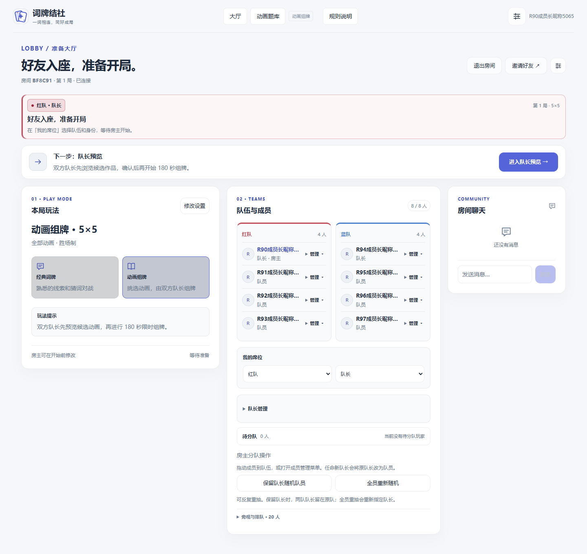 |  |
| 手机深色四人大厅 | 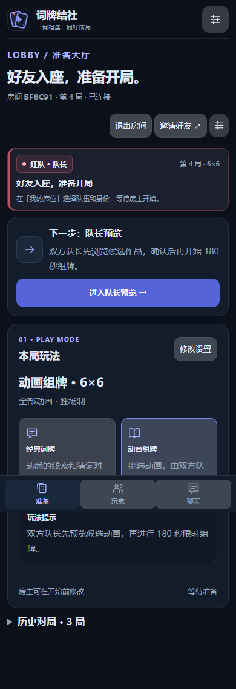 | 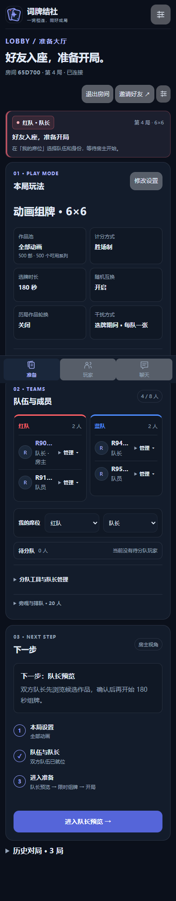 |
| 不均衡队伍／桌面深色 | 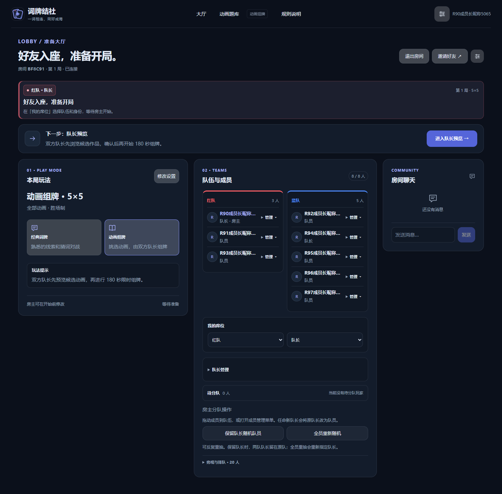 | 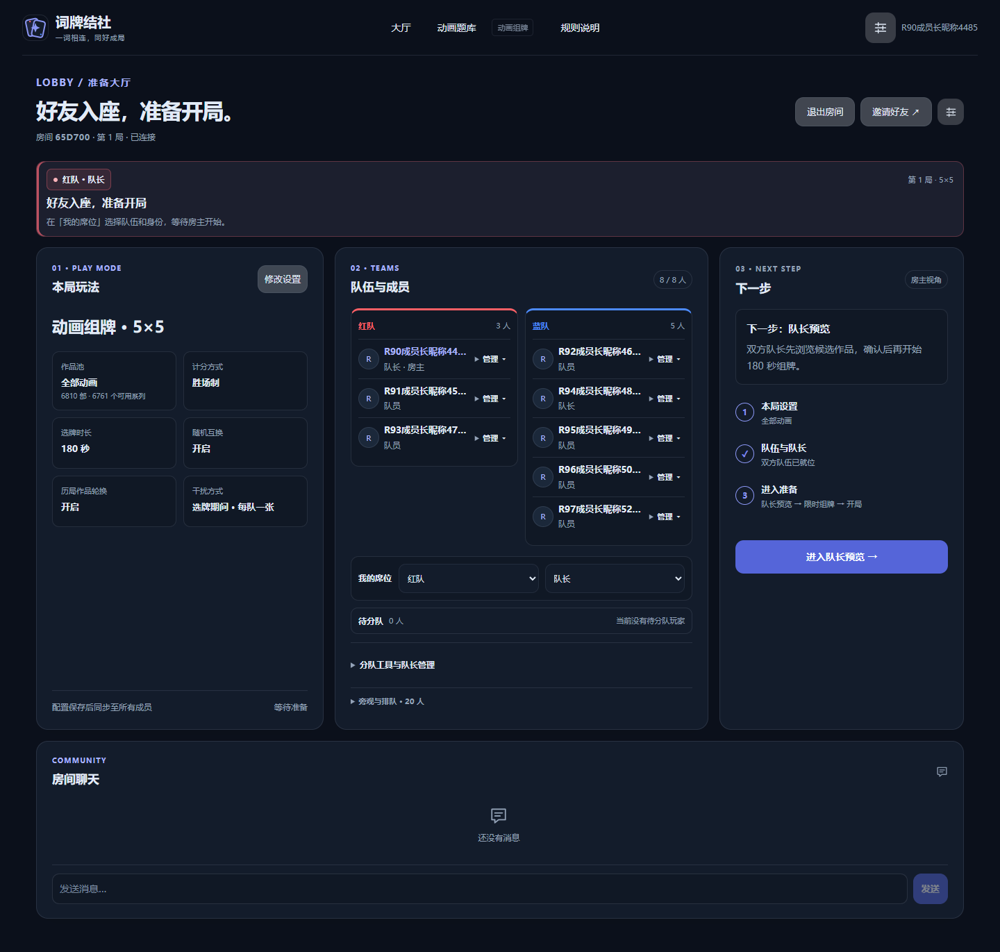 |
| 桌面设置 | 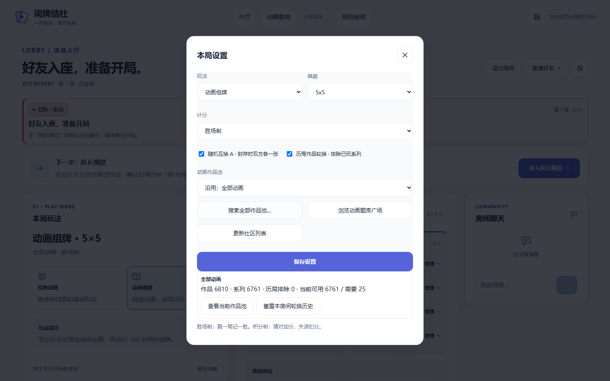 |  |
| 手机全屏设置 | 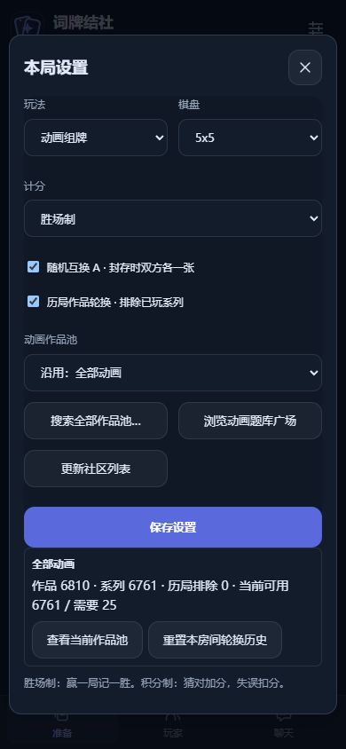 | 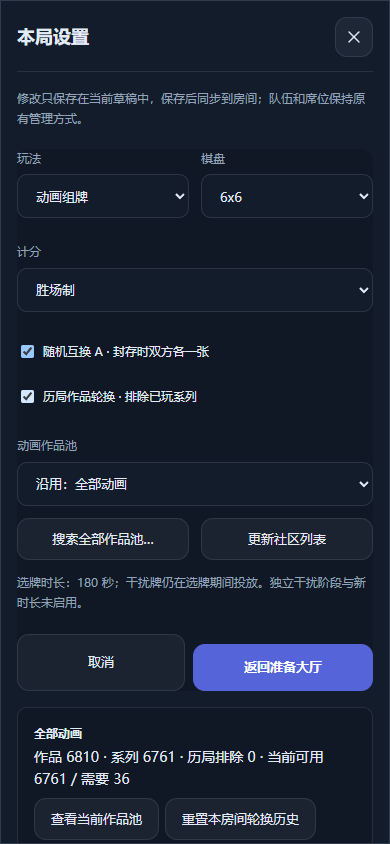 |
| 5×5 浅色四阵营 | 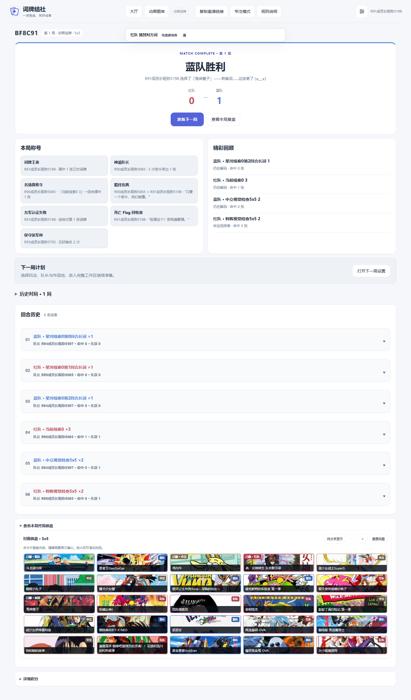 | 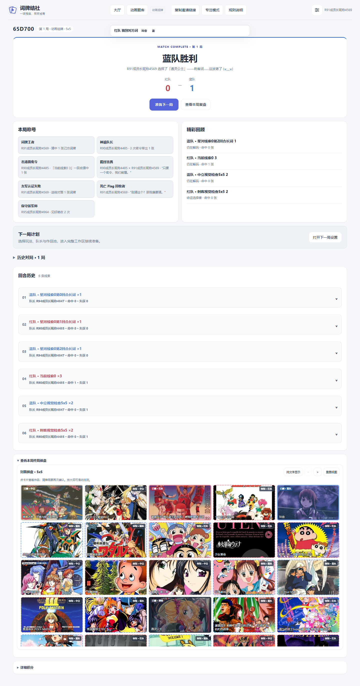 |
| 6×6 手机深色四阵营 | 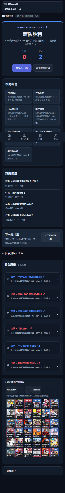 | 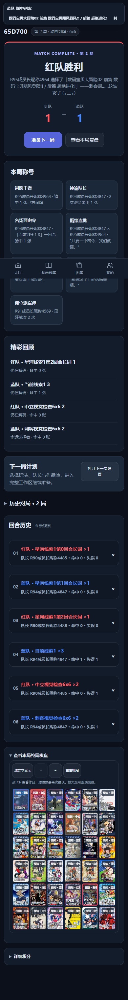 |
| 6×6 深色文字 | 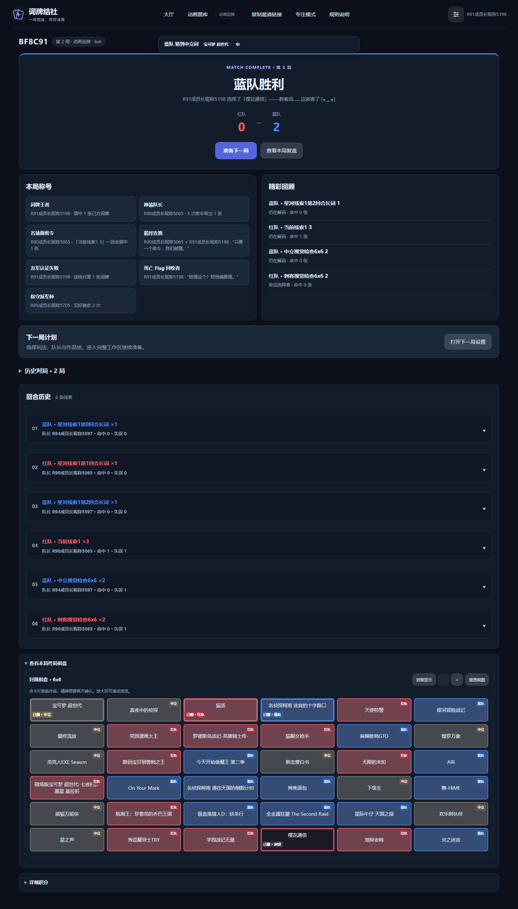 | 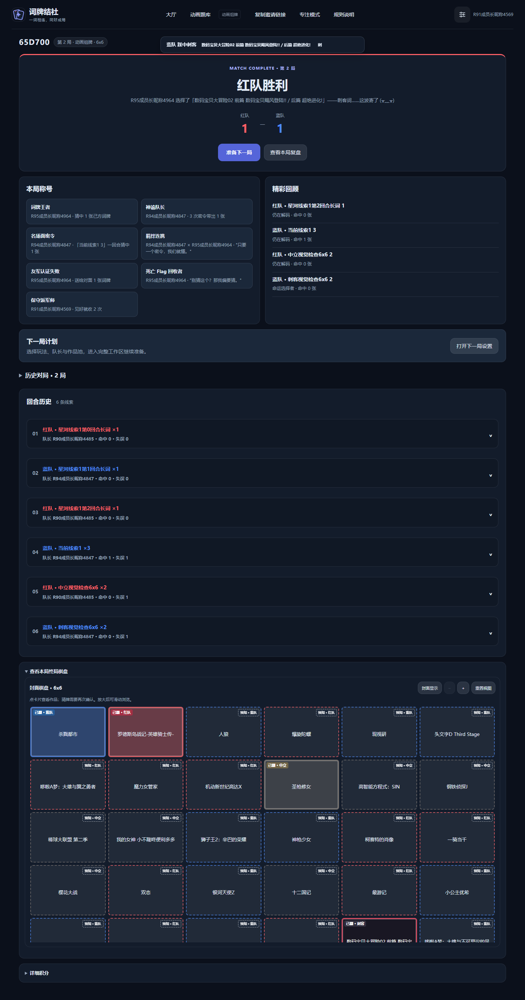 |
| 手机浅色复盘 | 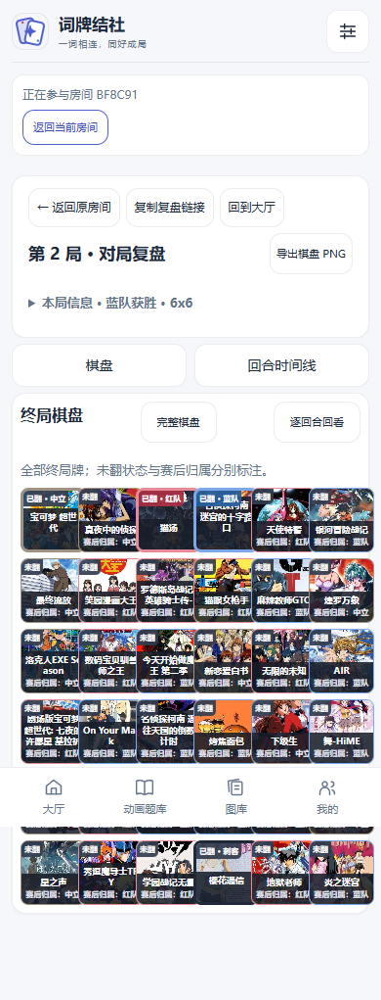 | 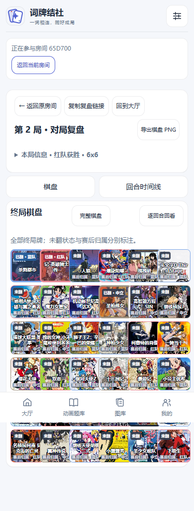 |
| 深色 16:9 导出 | 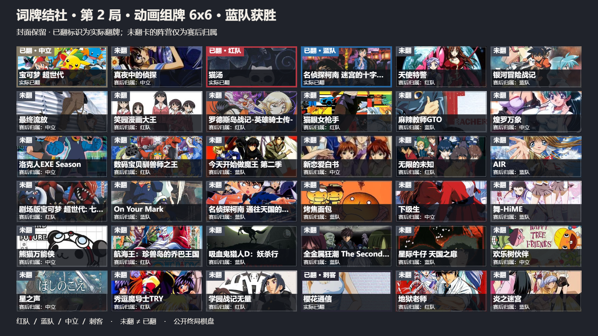 | 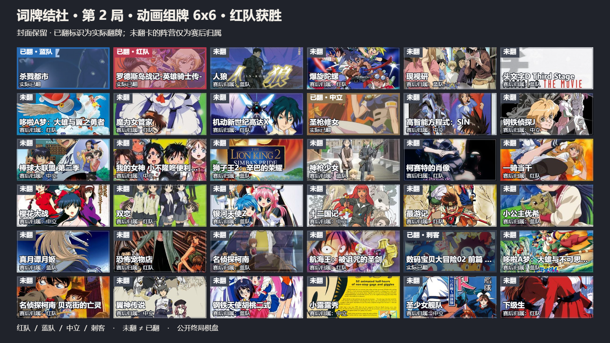 |

## 兼容与边界

选牌仍为 180 秒，干扰仍在选牌期间；未启用独立干扰、新时长或 manual-only 互换提案。没有修改游戏规则、权限模型、持久化格式或依赖锁文件。服务端只修正离开旧房间时误删新 Socket 绑定的既有竞态。

手机为 Chromium 触屏模拟，未使用实体 iOS／Android；未做三小时公网长测。构建保留既有大于 500KB 的 chunk 提示。本轮发布按用户最新明确授权执行，空房校验、一致性备份、数据哈希、Linux 构建、健康检查与代码回滚记录集中在部署报告。

## 分模块提交

- `88f470a`：大厅、设置和整牌蒙层。
- `8ba1cc5`：保存恢复和旧流程回归。
- `fdcb15a`：修复旧 span 选择器导致的下半实色条。
- `7f9445a`：主按钮与次要管理工具层级。
- `9ace324`、`457b3ef`：初始配置及离开旧房间的跨房间竞态。
- `9d12c60`：嵌套弹窗滚动恢复。
- `ae20430`、`0787596`：保留旧反馈并适配完整分页验收。
- `33347b5`、`49e25a7`、`842e7bd`：真实 CDN、懒加载截图和最终证据。

后续截图／部署报告提交见 [PR 提交历史](https://github.com/Zao-c/codenames-acg/pull/18/commits)。
