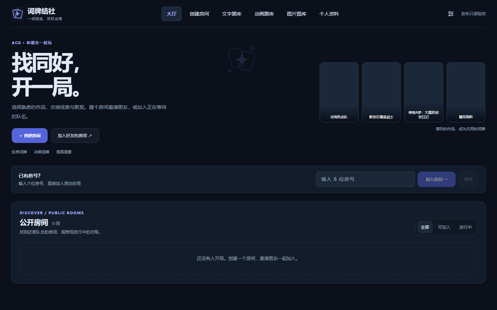
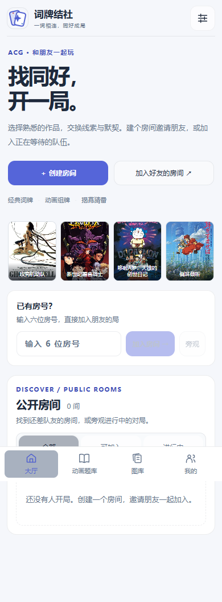

# Round 10 V2 生产部署

已按用户本轮明确要求发布到 [182.61.136.105](http://182.61.136.105/)。PR [#18](https://github.com/Zao-c/codenames-acg/pull/18) 保留待评审，未合并。

| 项目 | 实际结果 |
| --- | --- |
| 原生产 Git／运行 SHA | `59f2bd1aad922bad41d42b63ca0857b0102ad0b1` |
| 部署 Git／运行 SHA | `0e09d0aae15bccf8b94687184fffa4c1c79581a5` |
| 部署时间 | 2026-10-19 02:47:28 UTC（北京时间 10:47:28） |
| Node | v22.22.2 |
| 进程 | `codenames.service`，PID `1780126`，active／running，NRestarts=0，ExecMainStatus=0 |
| 健康 | `{"ok":true}` |
| 切换前房间 | 0；没有强制清除真实对局 |
| 发布后审核房间 | 0 |
| 持久文件核验 | 9 个文件全部通过 |
| 编译产物核验 | 74 个文件全部通过 |
| 配置 | `.env` 与发布前归档逐字节一致 |

测试截图源提交为 `20a30b1`；部署提交在其后只加入证据、文档及发布工具，应用源码没有差异。后续 PR 的部署报告提交也不代表服务器再次更新，实际运行 SHA 以上表及 [runtime-after.json](runtime-after.json) 为准。

## 发布过程与检查

使用 [deploy-round10.sh](../../scripts/deploy-round10.sh)：校验旧 HEAD、tracked clean 和提交祖先关系，核对上传 bundle 与脚本 SHA256，再在独立目录构建。复用已存在且锁文件完全一致的 Node 依赖，重定位 workspace 链接，不改变依赖版本、服务配置或 Nginx 配置。

核实真实 systemd 启动入口为 `apps/server/dist/apps/server/src/index.js`，在 Linux 上构建、语法检查，并使用隔离的 3199 端口和临时数据目录启动同一入口，健康检查通过后才进入切换。再确认生产房间为空、停止写入、创建一致性归档并核验，然后同步 shared／server／web 三个编译目录，核验数据及产物，写 release.json 并启动服务。

日志中进程就绪轮询的首次连接拒绝随后恢复；最终健康、服务状态及资源校验全部通过，没有触发代码回滚。原始发布输出见 [deployment.log](deployment.log)。

只读 [部署审计脚本](../../scripts/audit-round10-deployment.py) 复核实际 PID／工作目录／启动入口、Git 与 release SHA、持久路径、备份和公开资源。Nginx 实际返回的下列资源与构建文件逐字节一致：

- `/assets/index-C37-tFA0.js`，SHA256 `1634fa560d9aa7186aea235501b49775ea0e6473976b7a4ee7f327073ce54142`
- `/assets/index-Cwh4z7ey.css`，SHA256 `aede4fb97d341838817f9c5b1d0eabb56490d02b8640bf5f8a3034e3ec49dae5`

另用真实 Chromium 只读打开公网首页，桌面深色／手机浅色截图、新 JS／CSS 的 HTTP 200 和页面脚本错误 0 均通过，见 [浏览器结果](production-browser.json)。只在浏览器本地设置游客身份，没有创建生产账号、房间或比赛；完整 8 人＋20 旁观回归在隔离服务完成。

| 公网桌面深色 | 公网手机浅色 |
| --- | --- |
|  |  |

## 一致性备份与回滚

备份目录：`/opt/codenames-backups/round10-20261019T024648Z-0e09d0aae15b`。归档目录含 625 个条目，包含用户、作品池、导入、自建作品、封面目录，以及实际使用的嵌套 `apps/server/apps/server/data/reveal-images`。包含原 `.env`、服务与 Nginx 配置；备份留在服务器 root 保护目录，没有上传其内容到仓库。

| 归档 | bytes | SHA256 |
| --- | --- | --- |
| app-before.tar.gz | 50867801 | `eb601ac483dc6282cd68e9cd1545e02c649de8ab60ed0ed0e596b0116eb9b680` |
| system-before.tar.gz | 11975 | `f44dc35db81dad7d5c89fa7acc62413df232b8b71b9fff0b8e6ef5dd42307dd2` |

已验证压缩归档可读取、SHA256 一致、全部持久路径被归档；没有宣称做过恢复演练。`data-before.sha256` 与切换前后核验记录、74 个编译文件的核验记录保留于备份目录。

脚本内含失败时恢复原 SHA、三份编译目录与 release.json 的代码回滚。本次未触发。未来人工回滚须先重新确认空房与当前版本，再停服务，checkout 原 `59f2bd1`，只恢复备份下 `code/apps/server/dist`、`code/apps/web/dist`、`code/packages/shared/dist` 和 `release.json.before`，启动并重新验健康。不得把整个旧 app 归档覆盖到现目录，避免丢失发布之后产生的用户数据。内存中的活跃房间不能靠磁盘归档恢复。

公网复核不等同于实体手机或三小时长测；这些限制与完整测试矩阵见 [验收报告](ACCEPTANCE.md)。
