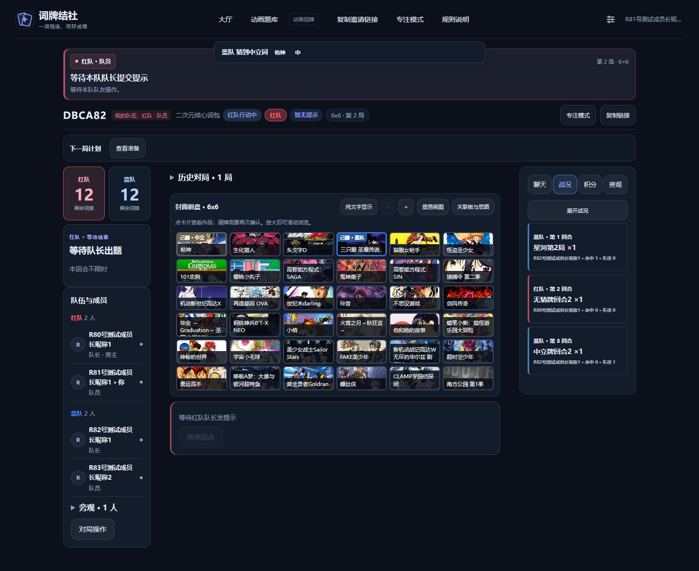
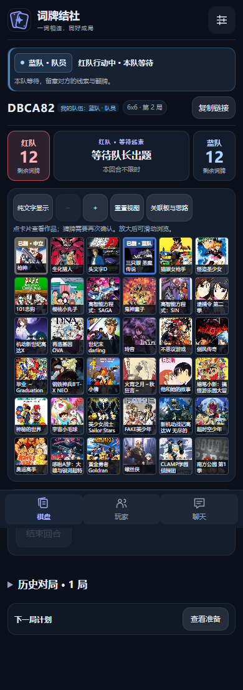
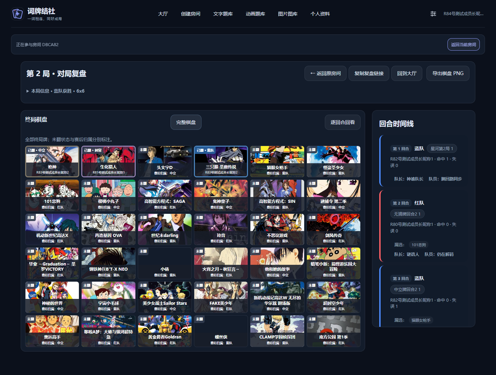

# Round 8 验收记录

开发基线为实际生产及 GitHub `codex/cipai-round7` 的 `5f75425153cb57079d149bdbe1c87d879b96dcb5`；开发在独立 worktree 的 `codex/cipai-round8`。本报告中的截图和联机数据均来自隔离测试房间。生产审计、身份凭证、业务数据、备份与运维脚本不提交至 GitHub。

## 行为与边界

- 正式棋盘、终局复盘及 PNG 均保留封面，用加粗边框和“已翻 · 阵营”区分实际翻牌。终局未翻牌另标“赛后归属”；逐步回看隐藏未来阵营，逐次累计真实猜牌，支持无猜牌回合。保留原卡片比例和顶部身份条 DOM 布局。
- 高光与成就在服务端和客户端按房间、对局、事件 ID 去重。队列标注触发阵营、局数及回合，过期回合不再排队弹出。结算页也接收终局通知。
- 公共和私密复盘切换 ID 时清空旧状态，阻断迟到请求；公开分享链接使用 `/replay/:id`，保留旧查询链接兼容。私密复盘仍校验原身份，明确提示过期、权限和进程重启失效。
- 对局默认战况；用户切换标签后不被新消息抢走。结构化回合卡展示公开猜牌，展开状态由用户控制，并提供宽屏战况窗口。原聊天、独立滚动、积分与旁观标签保留。
- 原组牌拖拽、350ms 触屏长按、幽灵、撤回、保护期、抢夺和原子替换保留。落点与释放动作读取最新权限，保护期和最后 20 秒非法落点不高亮，失败保留原牌。
- 新动画配置默认开启随机互换 A 和系列轮换，房主可关闭；已有动画配置缺字段时保持关闭。随机互换在封存事务中只执行一次，优先普通手选、零手选时选合法系统补位，排除干扰/中立/刺客；配额和作品集合保持不变，交换明细不公开。
- 轮换严格使用本房间已开局棋盘的 `seriesId` 集合，不删除源作品池。可用数量不足时阻止准备/开局，房主可确认重置记录或换池。支持完整源池预览与低数量提示，社区列表更新与轮换重置分开。
- 已选入改为中性半透明角标；队长选择收进管理折叠；取消准备靠近主操作并确认；公共及私密复盘统一进入“历史对局”。

## 自动化证据

19/19 项验收命令通过，Round 8 专项生成 80 张截图。最终命令状态见 [test-results.json](test-results.json)。`npm run verify:round8` 复用全部既有套件，并新增 Round 8 单测和多人浏览器回归；支持传入单个 npm script 名称复测，结果按命令更新。浏览器套件串行执行。

| 任务矩阵 | 证据 |
| --- | --- |
| B01–B03 | `MatchEventLedger`、`MatchNotifications` 单测；重复、旧房/旧局、迟到回合、五客户端真实终局事件唯一性 |
| R01–R07 | 公共失败→成功、延迟旧响应、三局独立 ID、同回合逐次累计、无猜牌回合、私密过期→授权、导航保留原房间会话 |
| U01–U06 | 1440×900 / 390×844、亮/暗、5×5/6×6、双方队长/队员/旁观；文字与封面翻牌状态、当前线索 |
| D01–D03 | 原有真实鼠标、CDP 触屏、10 秒保护、最后 20 秒、真实 180 秒、原子替换、blur/hidden/cancel 清理回归 |
| S01–S08 | 16 种尺寸/开关/双边与单边零手选组合；干扰排除、唯一封存、180 秒超时封存、版本/布尔校验、旧配置兼容及重连 |
| P01–P04 | 171 源作品预览；连续 25→36→25 三局合计 86 个不重复系列；耗尽拒绝、非房主拒绝重置、确认重置、取消准备不记历史 |
| IMG01–IMG02 | 8 种真实 PNG 下载和尺寸校验；CDN 匿名 CORS 实图、自建上传封面、长标题、坏图/网络失败回退、手机可保存图片 |
| PRIV01 | 队员/旁观者无队长声明、保护期、干扰来源、交换明细和完整房主源池；公开回放无私人图谱/意图/预测 |
| REG01 | 经典和揭幕 E2E、Bangumi 筛选/导入/社区池、手工混合池、三局正常目标牌获胜、账号隔离及关联板原权限 |

新增专项的三局使用四名玩家加一名旁观者，覆盖互换关闭/开启及两种棋盘。既有 Bangumi、稳定性和集中修复套件另验证正常清空目标牌获胜，避免仅用刺客结束代替完整玩法回归。旧套件中依赖小池重复使用的场景显式关闭轮换；默认开启及严格轮换由新增专项覆盖。

## 大目录部署回归补充

完整源池不再随每次 `room_state` 广播重复传输。房主点击预览时，通过身份及计划 ID/版本校验读取快照；旧请求在关闭窗口或切换计划后失效。作品池列表的系列数量也按目录变更缓存计算。

新增额外 5000 条导入记录的多人三局浏览器夹具，确认仍可分队、配置、读取 171 部源池、完成组牌/对局/回放和导出。单测验证 5000 部完整快照可由房主读取，其他身份及旧计划版本被拒绝，日常状态包不携带完整源池且至少缩小到原附带完整池方案的三分之一。

## 数据、发布与剩余风险

无依赖锁文件或数据库迁移。新增动画设置为可选布尔字段；封存交换记录只留在私有计划内；公共状态仅提供完成标志及池数量。新公共复盘字段 `roundNumber`、`matchId`、`mode.variant` 均可缺省，旧回放仍可打开。

当前生产使用内存房间存储；房间、轮换历史和私密复盘仍会在进程重启后失效，本轮没有把它们改造成持久化服务。生产已有房间时不得发布。正式切换前须重新核对活动房间、校验备份，并在停止写入后再取最终一致数据快照；程序回滚保留当前业务数据。

图片先通过浏览器匿名 CORS 加载，失败时由服务端按公开复盘内的卡片引用回退，仅允许两个 Bangumi CDN 域名、禁止重定向、限制 MIME/2MB/超时/频率。若客户端和服务器均无法取图，PNG 明示缺图数量并保留作品名与真实翻牌状态。服务器到 CDN 的网络限制不影响浏览器直连链路。

手机验收来自真实浏览器触屏模拟及下载/长按图片入口；未进行实体 iOS/Android 设备的系统相册保存验收。大规模观战数据只作本机性能证据，不能视为生产容量保证。

## 仅审计项目

`packages/shared/src/analysis-view.ts` 保持原权限：本队队长只读本队团队板，队员可读写，私人意图和预测按原有身份隔离。

| 待决路线 | 影响与后续验证 |
| --- | --- |
| 队员队内共享、队长不可见 | 减少队长受到队员分析反馈的影响；需同时检查团队板、增量消息、快照、私密复盘及换任后访问，不可只隐藏入口 |
| 全员公共可见 | 讨论更容易围观，但会公开对手推理与策略；需要明确公开时点，私人意图/预测仍须隔离，并测试双方与旁观者伪造请求 |

BP/Ban 未增加；关联板权限、8 人上限、计分规则、经典和揭幕规则、品牌与 Logo 均未改动。

## 截图

