# Round 9 开发与评审交付

PR：[词牌结社 Round 9 #16](https://github.com/Zao-c/codenames-acg/pull/16)，base 为 `codex/cipai-performance`（PR #15）。本轮在独立 worktree 开发，未部署、未重启正式服务。

## 基线与范围

已知 Round 8 为 `211401ee46bf205333d5a220d057a6fa09c71200`；只读核实正式 Git、release.json 和性能分支实际均为 `59f2bd1aad922bad41d42b63ca0857b0102ad0b1`。本轮从后者开发，保留已改善的目录请求、头像引用、增量广播、倒计时局部刷新和慢图迟到恢复。收尾复核正式服务仍 active、health 正常，PID 仍为 `1007817`，tracked 工作区无修改。

已完整阅读附件六份 Markdown，打开 HTML 的正式对局、房主分队、组牌及待确认干扰示意。附件原型只用于本地对照，没有复制模拟页面或裁切素材进入正式产品。

| 模块 | 主要文件与行为 |
| --- | --- |
| 棋盘与布局 | `apps/web/src/round9.css`、`RoomPage.tsx`：放大 5×5/6×6、解除中栏 680px 上限、专注模式同时放大宽高；手机末行可滚动到导航上方 |
| 线索与成员 | `RecentClues.tsx`、`MatchSummary.tsx`：最近三条及完整历史、队伍文字与行动队分开、成员有界滚动 |
| 右侧信息 | `RoomPage.tsx`、`Conversation.tsx`：战况/聊天/积分/旁观、固定未读角标、鲜花鸡蛋菜单、连接诊断折叠 |
| 通知 | `GameContext.tsx`：猜牌、高光、成就共用一个队列；事件 ID 与局范围去重，猜牌优先 |
| 房主管理 | `PreparationLobby.tsx`、`MemberManagement.tsx`、服务端 `game.ts`/`index.ts`：拖动、点击、键盘、单队长替换、移出成员、独立退出入口 |
| 封面与兼容 | `Cover.tsx` 保留原请求和迟到恢复，可读占位及重试；`AnimePlay.tsx` 补齐结算后嵌入配置的按需目录请求 |

新 `manage_member` 只接受绑定 Socket 的真实在线房主，在原房间锁内检查本房间目标、阶段、队伍、角色。仅未锁定 planning 大厅允许；guide/draft/sealed/countdown/playing 拒绝。揭幕猜番保留原裁判流程。移出仅使该房间旧席位恢复失效，不撤销账户或其它房间会话。保留原随机分队、房主接任、安全队长交接与断线恢复。

协议只增加事件及可选 `ChatMessage.connection` 字段，旧客户端继续使用既有事件；没有新增依赖、环境开关或数据迁移。未来发布时 shared/server/web 应按同一提交构建。没有改变拖牌命中、10 秒保护、末 20 秒禁抢、原子替换、公开匿名排序、私人收藏、计分和成就规则。

## 验证与证据

完整命令结果见 [test-results.json](test-results.json)，浏览器角色/视口/封面状态与几何数据见 [browser-results.json](browser-results.json)，配对性能原始数据见 [performance-comparison.json](performance-comparison.json)。各命令最终退出码和耗时如下。

| Command | Result | Seconds |
| --- | --- | ---: |
| `npm run test:e2e:local` | PASS | 67.29 |
| `npm run test:round5:local` | PASS | 72.58 |
| `npm run test:mixed:local` | PASS | 107.22 |
| `npm run test:lobby:local` | PASS | 47.81 |
| `npm run test:bangumi:local` | PASS | 179.6 |
| `npm run test:stability:local` | PASS | 85.7 |
| `npm run test:browser:local` | PASS | 94.13 |
| `npm run test:phase2:local` | PASS | 41.72 |
| `npm run typecheck` | PASS | 17.19 |
| `npm run test:rules` | PASS | 62.25 |
| `npm run test:concentrated:local` | PASS | 170.85 |
| `npm run test:round6:local` | PASS | 388.61 |
| `npm run test:round6:roles:local` | PASS | 53.43 |
| `npm run test:round7:ui:local` | PASS | 131.39 |
| `npm run test:round7:faults:local` | PASS | 73.61 |
| `npm run test:round7:load` | PASS | 62.2 |
| `npm run test:performance:unit` | PASS | 6.95 |
| `npm run test:performance:load` | PASS | 95.31 |
| `npm run test:round8:large:local` | PASS | 121.48 |
| `npm run test:performance:browser` | PASS | 236.66 |
| `npm run test:round8:local` | PASS | 101.49 |
| `npm run test:round9:local` | PASS | 126.36 |
| `npm run build` | PASS | 14.4 |

Final Round 9: 11 checks, 94 screenshots. Baseline: 92 screenshots. Application/test SHA: `195c888d45efe0a6960c6d2a4fd53fe338823dc6`.

Round 9 使用 8 个玩家浏览器、3 个旁观浏览器与另外 17 个真实 Socket 旁观者，共 20 个旁观席；另有既有 4 人及 20/50 旁观专项。171/500 系列来源池在包含 6810 部作品的目录中回归，其中 5000 条为隔离测试夹具；没有突破原接口 2500 ID 上限来制造“5000 选牌池”。

覆盖真实鼠标拖动、触屏/菜单/键盘入口、10 次真实传输断开后的自动恢复、在线 UI 移出及刷新拒绝恢复、离线成员/旁观移出、非房主伪造与全部锁定阶段。通知组合通过本地开发模块调用监听器注入重复高光/成就，猜牌本身走真实服务端；不把注入当作自然成就触发。未读压力使用真实旁观聊天，在既有频控内发送 102 条，检查 0→3→99+ 宽度不变。

性能浏览器专项含 8 个带头像客户端、2 个 390 宽触屏客户端（120ms/约 1Mbps/CPU 4×）、真实拖牌、刷新恢复、原封面 61 秒后成功且备用封面 503。倒计时以测试专用模块响应插桩计数，未变更的候选卡在 2.2 秒倒计时内重渲染 0 次；生产代码无计数器。原图与备用图均失败时另行验证可打开预览并确认猜牌。

早期发现和修复、异步测试调整、串行化以及本机分配失败记录见 [REVIEW.md](REVIEW.md)。旧“首屏必须显示整盘”断言依据本轮要求改为末行可滚动到达，横向溢出和交互断言保留。最终失败项目和未验证范围必须与下表及限制一并阅读。

## 几何与性能对照

| Board / viewport | Normal width before → after | Normal height before → after | Focus width before → after | Focus height before → after |
| --- | ---: | ---: | ---: | ---: |
| 5x5 / 1440px | 658 → 870 | 275 → 511 | 1074 → 1350 | 357 → 785 |
| 5x5 / 1920px | 658 → 1190 | 275 → 694 | 1074 → 1670 | 507 → 968 |
| 6x6 / 1440px | 658 → 870 | 330 → 593 | 1074 → 1350 | 429 → 913 |
| 6x6 / 1920px | 658 → 1190 | 330 → 806 | 1074 → 1670 | 609 → 1126 |

| Metric | 59f2bd1 | Round 9 |
| --- | ---: | ---: |
| Room bytes | 1971480 | 1971800 |
| Delta packets | 2160 | 2160 |
| Full snapshots during measurement | 0 | 0 |
| ACK P50 (ms) | 37 | 36 |
| ACK P95 (ms) | 51 | 45 |
| ACK max (ms) | 385 | 62 |
| Server peak RSS (MiB) | 257.0 | 246.7 |
| Server event-loop P99 (ms) | 388.0 | 60.5 |

Room bytes change: 0.02%; ACK P95 change: -6ms. Guard: bytes ≤ +5%, P95 ≤ baseline × 1.25 + 20ms; PASS.

配对负载为同机相邻串行运行，均为 8 人、180 候选、额外 5000 目录作品、240 个操作；运行期间不并行启动浏览器或构建。ACK 与广播字节数是本地 Socket 指标，不能推断公网承载量。

## 截图

本地 `output/playwright/round9/review.html` 可选择完整的前后场景，并切换左侧为附件 HTML 原型；原型明确标记模拟数据，新干扰未启用。每张真实截图的测试 SHA、角色权限和视口记录在 JSON。仓库仅保存下面的代表性实际应用截图，避免公开用户附件中的参考素材。

| Scene | Before | After |
| --- | --- | --- |
| board-5x5-1440-light.png | 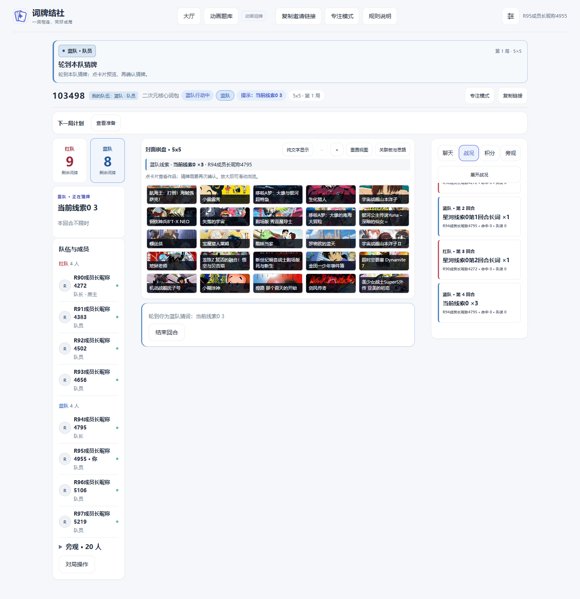 | 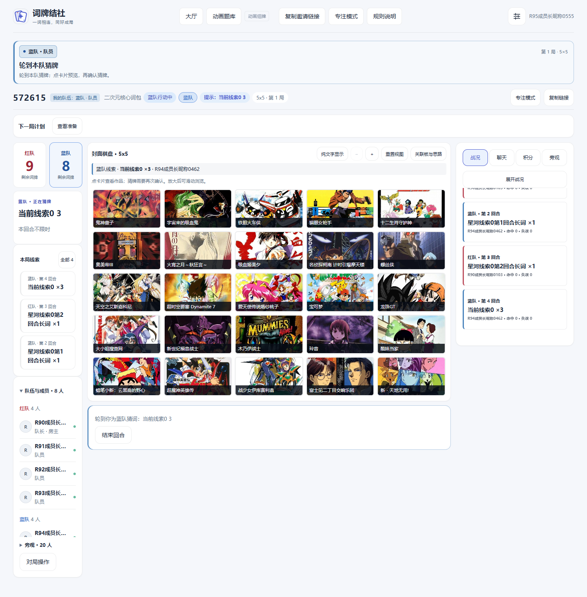 |
| board-6x6-1920-dark.png | 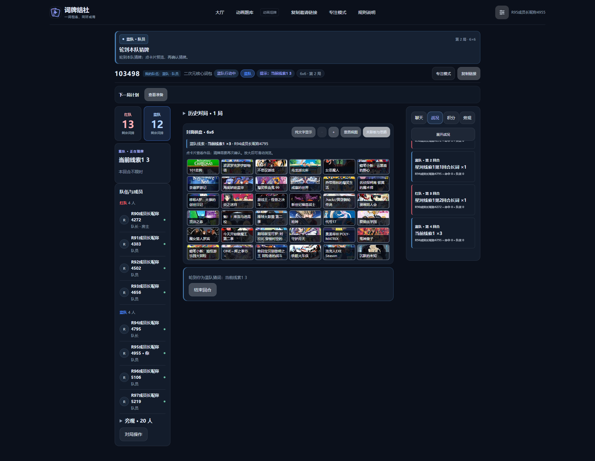 | 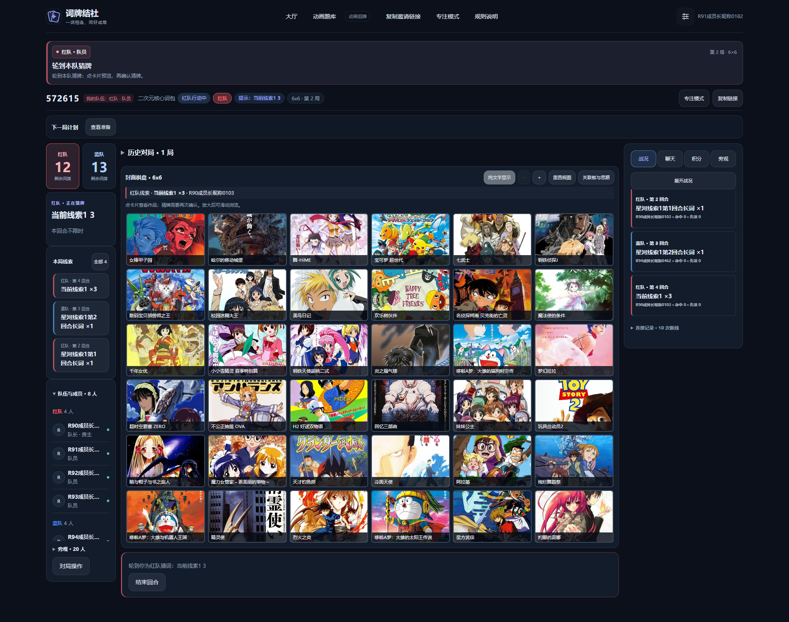 |
| board-5x5-390-light.png | 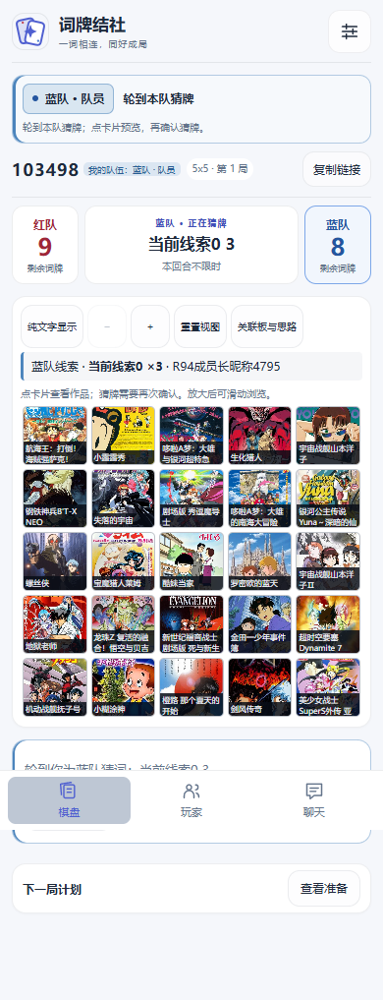 | 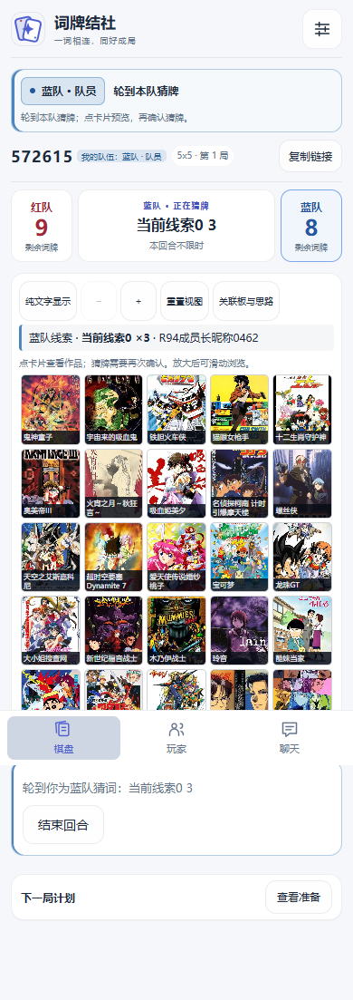 |
| board-6x6-390-dark.png | 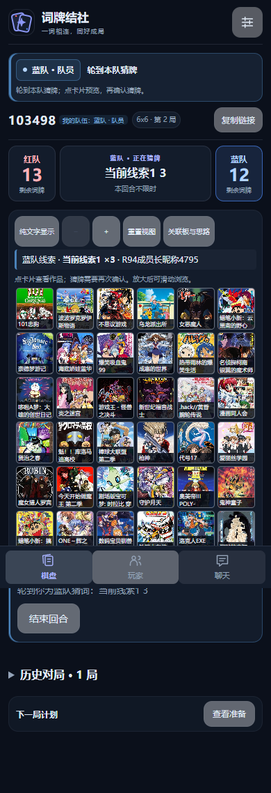 | 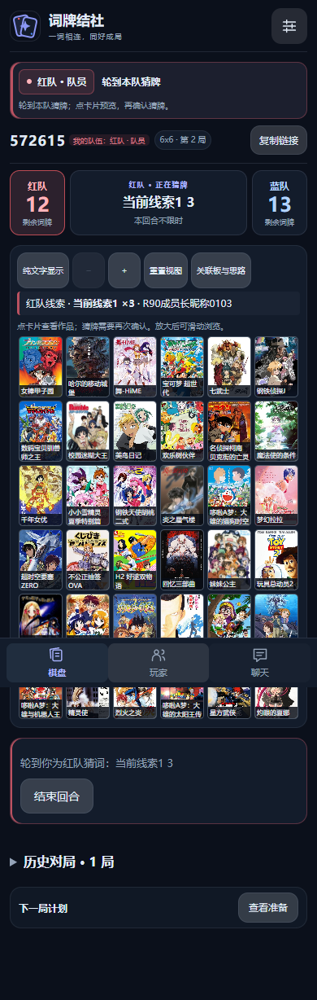 |
| focus-6x6-1920-light.png |  | 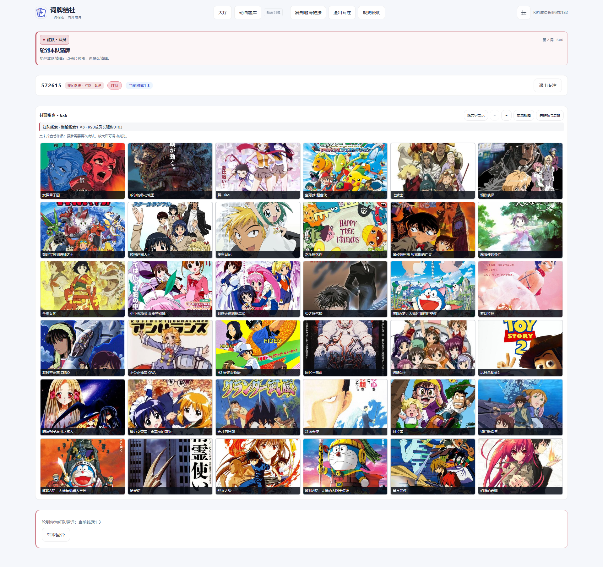 |
| lobby-1440-light.png | 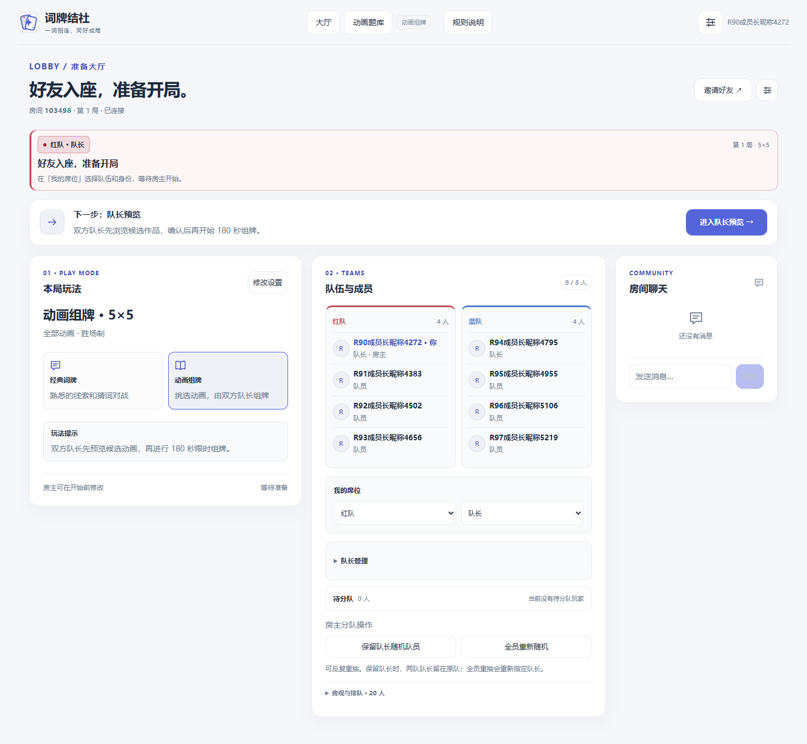 | 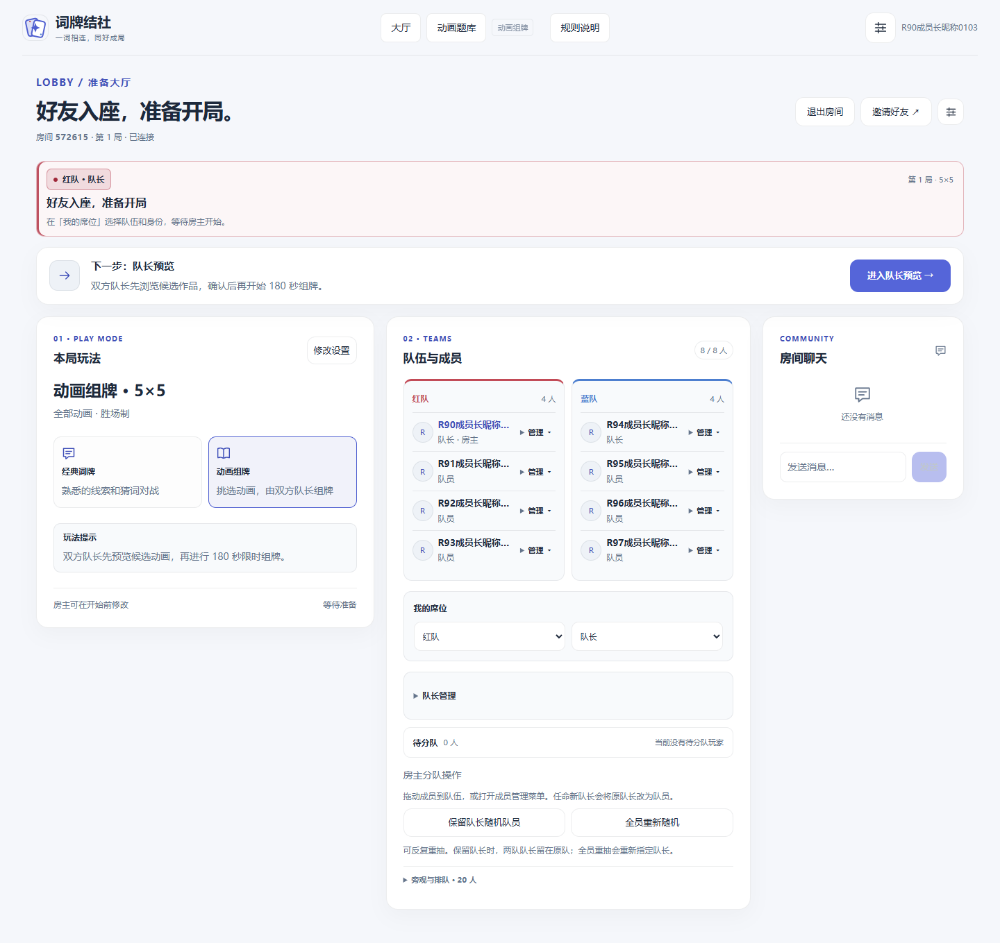 |

See [screens/manifest.json](screens/manifest.json) for SHA, viewport, role permissions, cover load counts and PNG hashes.

## 待确认规则与发布边界

[DRAFT_PROTOCOL_REVIEW.md](DRAFT_PROTOCOL_REVIEW.md) 交付 planning→guide→draft→interference→sealing→sealed→playing 状态机、规则快照版本、请求幂等、并发截止、权限投影和旧局/回放兼容方案。七类待确认决策包括时长及默认值、干扰开关和完成条件、替换/撤回/可见性、零手选处理、封存顺序、锁定阶段人员管理和离线队长推进。

这些规则没有产品入口，也没有切换现有房间。运行代码继续原 180 秒与原阶段干扰、原互换规则；manual-only 互换仅是提案。不能把附件干扰截图计作已实现功能。

本轮未创建新的生产备份或验证恢复演练。只读确认已有切换备份、配置及持久化目录存在；不将“存在”宣称为备份完整性验证。将来发布须取得另行授权，复核空闲维护窗口、停止写入后做一致性备份，记录当时 HEAD 和构建版本。代码回滚参考为 `59f2bd1`，shared/server/web 同步恢复，但不得用旧备份覆盖随后产生的用户数据。内存房间不能由磁盘备份恢复。

本轮手机为 Chromium 触屏模拟，未验证实体 iOS/Android；未执行三小时公网长测。保留既有大于 500KB 的构建分包警告，没有借本轮重构改动整个打包结构。

## 模块提交

| SHA | Module |
| --- | --- |
| `b22e785a3a9eab2e79576347a663979b3952fafe` | docs(round9): verify live performance baseline and propose gated draft protocol |
| `c5875f395329a5b65407fb511db3e78ebe7325e1` | feat(round9): authorize lobby member management and aggregate connection diagnostics |
| `619dcc8bbc66cfc3e5810afaab3639c67b2d7969` | feat(round9): enlarge match boards and rebuild panels with unified notices |
| `bcd2fbea60924474e8dafce0064de5e50f775e8b` | fix(round9): keep slow covers in flow and refine mobile member controls |
| `72232867db973af291ff5690e25597ba987f5091` | fix(round9): scale focus rows and complete explicit lobby exit |
| `12426ddfa801d920fc727a949a8e45647283a6d9` | test(round9): add multiplayer visual matrix and retain scroll reachability checks |
| `c03795e16306e57ada05d9ab333ca6f9d0380b08` | test(round9): capture revealed cards and both focus themes |
| `be1bb00547eaf8d5e6b0b059a853c04606a2b505` | fix(round9): load embedded configuration on demand and tighten mode guards |
| `9bf0e5f1f49df493b7696a976d2be3e3f8baca01` | test(round9): verify countdown renders and twenty spectator interactions |
| `2e019d684d6b5f6ba82c64a746691d5850fc8fed` | fix(round9): keep card preview clickable through failed cover placeholders |
| `3be9ac9a2da6448e39483cbb1cea7795489baa3a` | test(round9): complete review evidence, unread stress and cover failure flows |
| `7fa4ad928014da7ee5a647b4edf5029544c10493` | test(round9): finalize isolated comparison and prototype review matrix |
| `11c8ef3a1eaf557380d0a74d47b5c328cebc879b` | test(round9): verify acknowledged unread waves within bounded history |
| `195c888d45efe0a6960c6d2a4fd53fe338823dc6` | test(round9): resolve failed suite before final evidence gate |

Evidence archive commits are also listed in the [PR commit history](https://github.com/Zao-c/codenames-acg/pull/16/commits).
