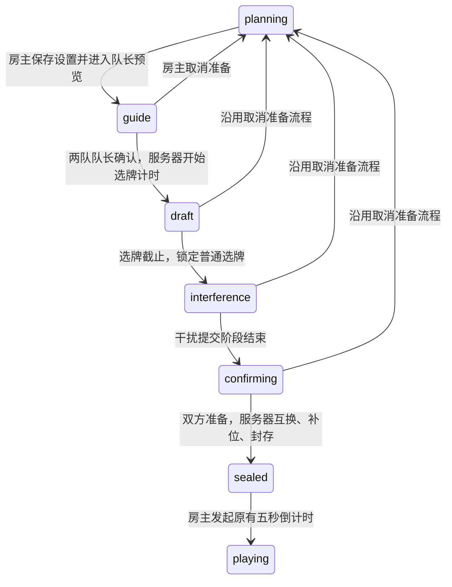

# 可调选牌时间与独立干扰阶段：服务端契约评审

依据：本轮用户列出的七步流程。先前 Round 9 提案只作历史参考；其中“45 秒干扰”“零手选跳过互换”“双方提前完成便封存”等未批准建议，不作为本轮既定规则。

核对起点：GitHub main `f4dba98`，最新评审分支 `ad30492`（PR #18），实际生产 `a73ad5a`，健康检查通过。新工作区 `.worktrees/staged-draft`，分支 `codex/cipai-staged-draft`，从 `ad30492` 创建。此文件是可评审的实施契约，运行代码与生产规则尚未改变。

## 本轮已明确的顺序

“互换、补位、封存”在同一房间锁内原子完成，不留一个允许额外操作的公开 `swapping` 中间状态。双方确认前不会开始正式游戏。

`confirming` 只表示干扰截止后仍需确认的等待状态，不增加第二次准备操作。队长在干扰阶段已经点击的准备继续有效；双方已准备时可直接原子封存。干扰超时是否自动视为准备，取决于下面 A 的确认结果。

1. 房主设置选牌时长，5×5、6×6 都可以选择 **180／240／300 秒**，不再由棋盘固定为 180 秒。
2. 在完整选牌时间内，保留现有普通领取、抢夺、撤回、原子替换与 10 秒保护期。
3. 最后 20 秒仅禁止抢走对方的普通牌；空闲牌领取、自家撤回和合法替换继续可用。正在保护期内的对方牌也继续不可抢。
4. 服务器判定选牌时间到后，冻结双方普通选牌，再进入独立干扰阶段。按这次“时限结束之后”的描述，不沿用旧版“双 done 直接封存”的捷径。
5. 干扰阶段只能给对方选择一张干扰牌，不能继续抢、撤回或替换普通手牌。队长能查看双方冻结的普通选牌，队员及旁观继续沿用匿名信息规则。
6. 双方完成干扰并点击准备后，系统从双方普通手选集合中各随机抽一张，交换归属，再补齐其他空位并封存。干扰牌不参与抽样。
7. 成牌后进入原有等待房主开局流程，继续使用既有队长在线检查、五秒倒计时及取消倒计时行为。

第 6 步的“互换”沿用现有作品留在棋盘、两张作品交换红蓝归属的含义，双方牌数不变。新流程下互换是成牌步骤；旧流程仍按原有随机互换开关处理。

## 设置面板与阶段显示

| 设置 | 新流程选项 | 默认值提议，尚未启用 |
| --- | --- | --- |
| 选牌时间 | 3／4／5 分钟，两个棋盘尺寸均能手动选 | 5×5：3 分钟；6×6：5 分钟 |
| 干扰时间 | 30 秒／60 秒／不限时 | 30 秒 |
| 成牌前随机互换 | 每队一张普通手选牌 | 新流程固定执行 |

所有设置保存后同步到准备大厅的本局玩法摘要。倒计时从双方确认开始选牌时才计时，进入干扰阶段后显示单独的倒计时；不限时明确显示“干扰阶段 · 不限时”，不使用无限数值伪造截止时间。

在普通组牌面板去掉原有干扰拖拽目标，保留普通牌原有鼠标、触屏和预览替代操作；独立干扰页面突出“对方普通手牌”“选择要投给对方的作品”和“准备”。投放前二次确认，普通选牌与干扰牌使用不同标签。

## 三个必要待答边界

### A. 干扰限时结束但尚未投牌

需要选择：系统随机补一张并自动确认／该队不投牌且自动确认／暂停等待。时间到并不等同于队长已经点击准备，最终如何处理必须先确定。

不限时模式没有自动到期，应等双方确认；离线恢复、现有安全队长交接及房主取消准备仍可用。

### B. “动画池”的范围

建议为**本局所选作品池快照**中的合法空闲作品，允许选择未出现在本次最多 180 张候选里的作品。另一种选择是仅允许本次候选池。两种都遵守同系列去重、已选作品排除与既有历史轮换条件。

不会扩大到房间未选的全站动画库，也不会读取其他人的私人作品池。

如果采用完整作品池，需要新增两位真实队长专用的分页接口：按 `roomId + planId + stageVersion` 鉴权和绑定快照，返回当前页至多 60 部。继续使用已经选择的作品池快照，不因社区池随后编辑而漂移。现有“房主查看完整作品池”接口权限保持原状。

干扰牌元数据不写入所有成员收到的候选数组；仅在授权的队长视图提供最多两张已选干扰作品。候选数组继续不超过原有上限，避免把几千部作品重新广播给所有成员。

### C. 某队截止时没有任何手选牌

现行互换优先从手选牌中抽取，零手选时用系统补位牌兜底。本轮明确要求普通手选牌，所以必须确定零手选分支：

- 严格手选：等待该队补选至少一张普通牌，再继续。需要清楚的“缺少普通手选牌”恢复界面，仍不允许抢对方冻结的牌。
- 允许兜底：沿用系统补位牌参与互换，但明确标记为系统补位，不伪装成人工选牌。

不能暗中采用旧提案的“跳过互换”，也不能抽取干扰牌代替。

## 牌数与互换条件

沿用现行配额，不额外增牌：

| 棋盘 | 先手阵营总数／普通手选上限 | 后手阵营总数／普通手选上限 | 中立／刺客 |
| --- | --- | --- | --- |
| 5×5 | 9／7 | 8／6 | 7／1 |
| 6×6 | 13／10 | 12／9 | 10／1 |

干扰牌继续占接收方原有随机补位位置，不占普通手选额度。缺少普通牌时的剩余位置按现有随机补齐规则处理，零手选互换分支按 C 的最终选择处理。

封存顺序：校验冻结的普通选牌 → 校验干扰牌及全棋盘系列唯一 → 从合格普通手选集合中各抽一张并互换 → 随机补齐阵营、中立及刺客 → 打乱和封存。交换不会改变红蓝总数，不会重复抽取或重复生成棋盘。

## 服务端快照、竞争与权限

建议在计划内新增可选 `draftRules` 快照，包含 `version: 2`、`selectionSeconds`、`interferenceSeconds`（`null` 表示不限时）及已批准的边界策略。明确启用新流程时一次保存，正式准备后不允许改时长；改变设置需要先取消准备。

使用独立 `selectionEndsAt`、可选 `interferenceEndsAt`，并记录 `stageVersion`。旧版 `endsAt` 保留在 v1，不把“无限时”序列化为 `Infinity`。阶段时间由服务端设定；新阶段从实际转换时刻起算，避免服务器短暂延迟吞掉整段干扰时间。

所有截止推进、队长操作、双方准备和重连触发的检查共用一个房间锁内的 `advancePreparation`，重新读取最新计划后决定是否推进。截止后的旧阶段操作不能被误解释成下一阶段的动作。

v2 写请求携带 `roomId / planId / stageVersion / version / requestId`。以 Socket 绑定的真实成员判定权限；在有界缓存中用成员、计划和请求 ID 做去重，同 ID 换载荷应拒绝。重复提交、ACK 丢失、双准备与时钟同时触发只能产生一次互换。重放确认也必须重新经过当前身份权限判断，不能让被撤换的队长继续读取秘密。

只有当前两位指定队长能普通选牌、投放和准备；房主不兼任队长时不能代选。已准备一方能否取消准备或更改干扰，以及未准备前是否允许替换干扰，将作为页面方案的一部分标注后再启用。准备成功与互换结果不通过房间公共消息泄露具体作品。

队员和旁观继续只收到匿名普通已选集合，不收到归属、操作者、保护时间、干扰作品、书签或互换来源。现有增量投影继续复用稳定作品元数据，正式封存后再沿用原游戏阶段可见性。

当前生产是内存房间。可以保证同一运行进程内重连与互换幂等；跨进程恢复需要持久化事务，不能把本次改动描述为已经支持重启恢复。

## 兼容与上线边界

- 旧房间、旧计划没有 `draftRules.version=2` 时继续使用 v1：180 秒、同阶段干扰与原互换开关；不重置进行中的倒计时。
- 新流程仅在尚未开始准备的计划中由房主保存。已进入 guide／draft／sealed 的旧计划不静默转换；房主返回未锁定准备阶段后才能重新配置。
- 老客户端不能担任不认识新阶段的 v2 队长，须有客户端能力声明及清楚的刷新提示；不能把干扰阶段伪装成旧版 draft。
- 经典文字玩法、历史公开复盘及当前关联板／匿名组牌权限继续按原协议读取。新公开复盘最多增加规则版本和互换完成摘要，不公开私人来源和书签。
- 在 A／B／C 及默认值、准备撤销语义最终确定前，不开放可启用该协议的产品入口，也不部署新玩法。

## 分模块实施与验收

1. shared 与服务端：v2 快照、阶段转换、权限、截止和一次性封存；先补状态机、竞态与隐私测试。
2. 前端设置：3／4／5 分钟、30／60 秒／不限时、准备大厅摘要及错误恢复。
3. 组牌与干扰界面：保留原拖拽与替代操作，锁定普通牌、专用分页作品池、双队准备与互换反馈。
4. 兼容、全流程和性能：新旧协议并存、旧客户端处理、8 玩家＋20 旁观增量同步、弱网和大作品池回归。

重点测试：180／240／300 秒配置；截止前后 1 毫秒和最后 20 秒边界；30／60 秒／不限时干扰；两队同选作品的竞争；投放去重和历史轮换；干扰牌不进入互换；零手选分支；最后一次投放、双准备、timer 与重复 ACK 竞争；断线跨阶段及队长交接权限撤销；5×5／6×6 固定牌数；所有角色投影与回放；当前房间不会因升级被重置。
